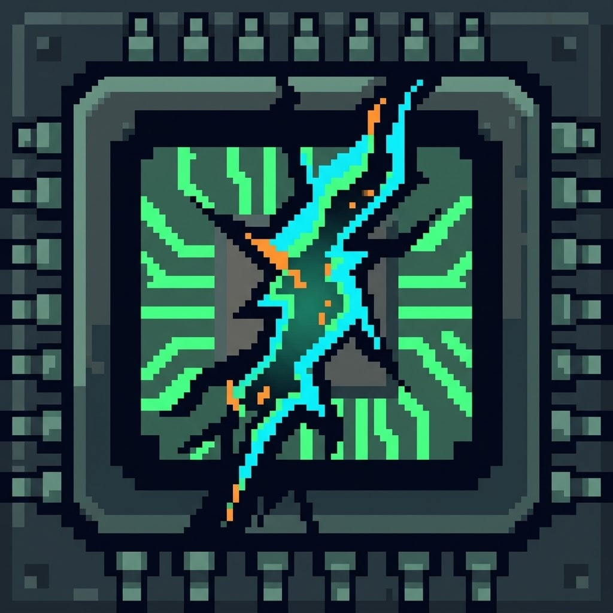
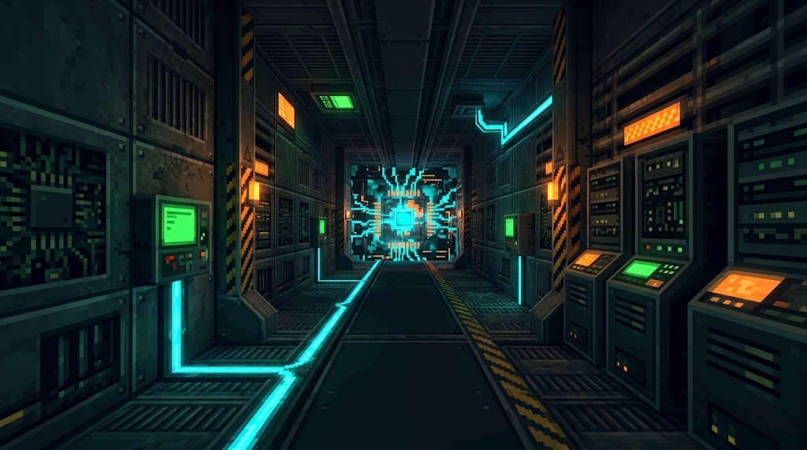
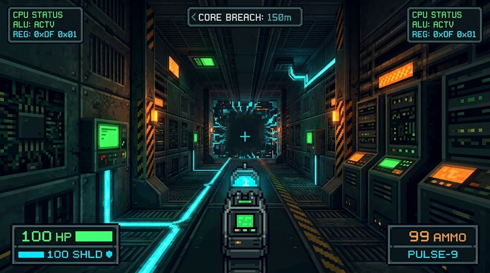
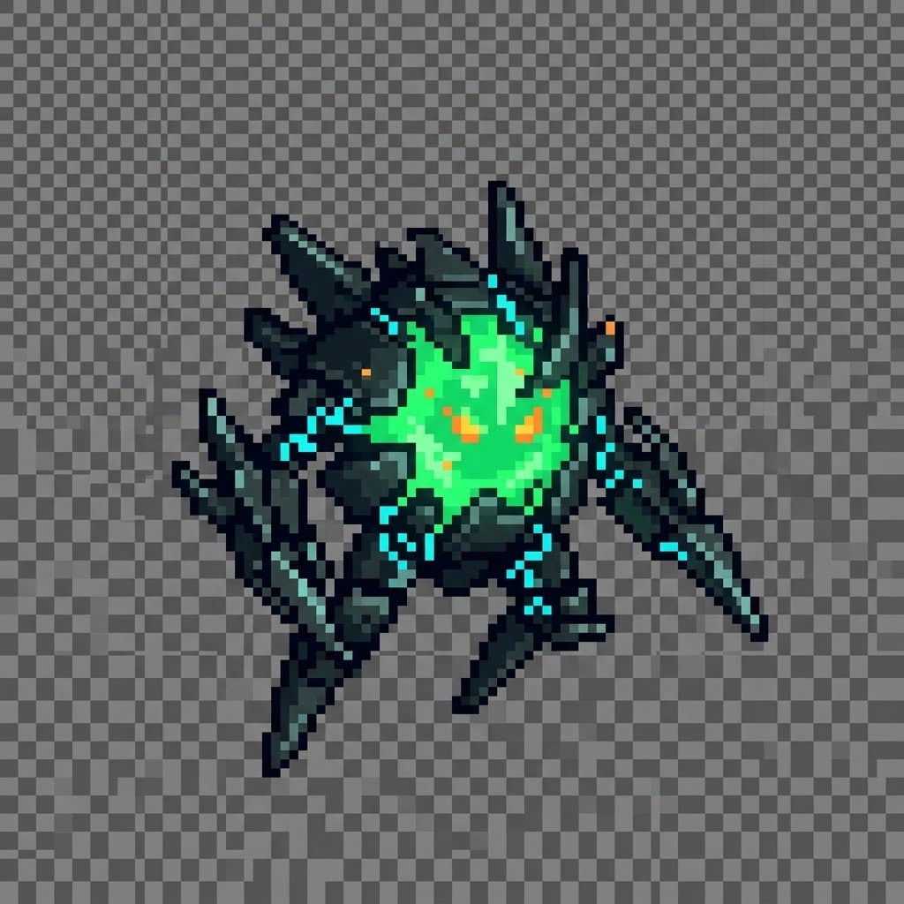

# CORE BREACH

<p align="center">
  
</p>

<p align="center">
  <strong>Jogo FPS educacional arcade focado no ensino prático de Arquitetura de Computadores.</strong>
</p>

---

## 📌 Sobre o Projeto

**CORE BREACH** é um jogo de tiro em primeira pessoa (FPS) desenvolvido para navegadores desktop com estética sci-fi retrô inspirada nos clássicos dos anos 90 (como *Doom* e *Quake*).

Ambientado no interior de um processador computacional corrompido, o jogador assume o papel de um programa de segurança com a missão de combater ameaças digitais hostis, purificar setores corrompidos e restaurar o núcleo central do sistema.

O diferencial pedagógico está em transformar conceitos abstratos de **Arquitetura e Organização de Computadores** em mecânicas dinâmicas de jogo, integrando operações lógicas, registradores, ciclo de instrução e componentes de hardware diretamente ao gameplay.

---

## 🎮 Principais Características

- **Combate Arcade Dinâmico:** Movimentação ágil, disparos rápidos e confronto contra hordas de processos corrompidos.
- **Aprendizagem Integrada:** Mecânicas de combate e resolução de quebra-cabeças baseadas em lógica booleana (AND, OR, NOT, XOR), ciclo *Fetch-Decode-Execute* e registradores.
- **Direção de Arte Sci-Fi Retrô:** Estilo retro-futurista 2.5D/3D com iluminação neon, painéis de circuitos, terminais tecnológicos e sprites estilizados.
- **Acessibilidade Web:** Desenvolvido para rodar direto no navegador desktop, com controles familiares (WASD + Mouse) e sessões rápidas.

---

## 🖼️ Galeria de Conceitos & Assets

| Cenário Principal | HUD & Interface |
| :---: | :---: |
|  |  |

| Inimigo Melee / Hostil | Ficha do Protagonista |
| :---: | :---: |
|  |  |

---

## 📂 Estrutura do Repositório

```text
CoreBreach/
├── assets/          # Texturas, conceitos de HUD, sprites de armas, inimigos e logos
├── docs/            # Documentação completa de Game Design e Engenharia de Software
│   ├── BRIEFING.md                 # Visão geral de produto, proposta pedagógica e narrativa
│   └── DOCUMENTO_DE_REQUISITOS.md  # Requisitos funcionais, não funcionais e casos de uso
└── README.md        # Apresentação do projeto e guia geral
```

---

## 📖 Documentação Detalhada

Para mais detalhes sobre as especificações do jogo e arquitetura:
- 📄 [Briefing de Produto e Desenvolvimento](docs/BRIEFING.md)
- 📋 [Documento de Requisitos de Software](docs/DOCUMENTO_DE_REQUISITOS.md)

---

## 🛠️ Tecnologias & Plataforma

- **Público-alvo:** Estudantes de Ciência da Computação, Engenharia de Software e entusiastas.
- **Plataforma:** Web (Navegadores Desktop modernos).
- **Iniciação Científica (IC):** Projeto desenvolvido no âmbito acadêmico para gamificação do ensino de Arquitetura de Computadores.

---

## 👤 Autor

- **Arthur Ferreira** - [@arthferreirw](https://github.com/arthferreirw)
