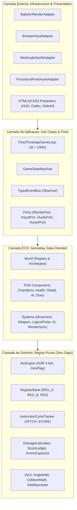

# ARQUITETURA DE SOFTWARE — BREACH CORE (CORE BREACH)

**Versão da Arquitetura:** 1.0.0  
**Padrão Arquitetural Primário:** Clean Architecture + Hybrid ECS (Entity-Component-System)  
**Paradigma:** Orientado a Dados (Gameplay/ECS) + Funcional/POO Puro (Domínio Matemático e Lógico)

---

## 1. Visão Geral e Stack Tecnológica

O **Breach Core** é um First-Person Shooter (FPS) arcade educacional 3D em tempo real executado no navegador desktop.

- **Linguagem:** TypeScript 5.x (`strict: true`, `noUncheckedIndexedAccess: true`)
- **Build Tool / Bundler:** Vite 6.x
- **Renderizador 3D:** Babylon.js 7.x (WebGL2 / WebGPU ready) operando estritamente como *Render Adapter*
- **Interface (HUD / Menus):** HTML5 Semântico + CSS3 Dinâmico (Retro Terminal Style)
- **Áudio:** Web Audio API (Sintetizador Procedural Retro)
- **Testes Unitários e Integração:** Vitest
- **Testes End-to-End (E2E):** Playwright

---

## 2. Mapa de Camadas e Regras de Dependência (Clean Architecture)

A dependência é estritamente unidirecional, apontando para o centro:
`Presentation / Infrastructure` $\rightarrow$ `Application` $\rightarrow$ `ECS Kernel` $\rightarrow$ `Domain`.

### Regras de Ouro:
1. **Domínio (`src/domain/`)**: Código TypeScript 100% puro. Proibida qualquer referência a DOM (`window`, `document`), Babylon.js (`@babylonjs/*`), Node.js APIs de I/O ou camadas externas.
2. **ECS (`src/ecs/`)**: Componentes são estruturas puras de dados (Plain Old Data). Sistemas contêm a lógica e iteram sobre entidades sem acoplar diretamente a APIs gráficas do navegador.
3. **Aplicação (`src/application/`)**: Orquestra sessões de jogo, estados de tela e comunicação por barramento de eventos através de interfaces (`ports/`).
4. **Infraestrutura e Apresentação (`src/infrastructure/`, `src/presentation/`)**: Implementam as portas concretas (Babylon.js, DOM, Canvas2D, Web Audio).

---

## 3. Registro ECS (Componentes e Sistemas)

### Componentes Chave:
- `TransformComponent`: Posição 2D/3D (`x, y, z`) e rotação (`yaw, pitch`).
- `VelocityComponent`: Vetor de velocidade linear (`vx, vz`).
- `ColliderComponent`: Raio de colisão circular e flag de solidez.
- `HealthComponent`: Vida atual e máxima (`hp, maxHp`).
- `ShieldComponent`: Escudo primário de absorção de dano do jogador (`shld, maxShld`).
- `BinaryLockComponent`: Registrador binário de 4 bits (`REG_B`), flag ativo e tempo de atordoamento (`stunTimer`). Utilizado tanto no inimigo `OVERFLOW` quanto em `Portas Tecnológicas`.
- `AiFsmComponent`: Estado da IA (`IDLE`, `CHASE`, `ATTACK`, `STUNNED`, `DEAD`), arquétipo (`BITLING` ou `OVERFLOW`), alcance e timers.
- `WeaponComponent`: Cadência de tiro, munição atual/máxima e temporizadores de recarga.
- `LogicalPulseComponent`: Cooldown do pulso XOR (3.0s) e flag de disponibilidade.

### Ordem de Execução dos Sistemas por Frame:
1. `PlayerControlSystem`: Lê snapshot de entrada e aplica velocidade/intenção de disparo.
2. `MovementAndCollisionSystem`: Integra velocidade com *wall-sliding* no grid do setor.
3. `TargetInspectionSystem`: Inspeciona o alvo sob o retículo da mira.
4. `WeaponSystem`: Disparo da `PULSE-9` e cálculo de impacto via raycast DDA.
5. `LogicalPulseSystem`: Resolução do Pulso XOR na ULA e aplicação de dano/quebra de escudo (`ZF=1`).
6. `AiFsmSystem`: Atualiza lógica e detecção de linha de visão dos inimigos.
7. `ProjectileSystem`: Movimenta e testa colisões de projéteis inimigos.
8. `InteractionAndDoorSystem`: Interação com terminais de dados e abertura de portas destravadas.
9. `PickupSystem`: Coleta de itens no mapa.
10. `InstructionCycleSystem`: Avança o sequenciador didático `FETCH -> DECODE -> EXECUTE -> STORE`.
11. `RenderSyncSystem`: Comunica transformações e estados visuais para `IRenderPort`.

---

## 4. Architecture Decision Records (ADRs)

### ADR-001: Adoção de Clean Architecture com Hybrid ECS
- **Contexto:** Necessidade de construir um jogo com alta testabilidade lógica (cálculos de CPU, ULA, ciclo de instrução) desvinculado do ciclo de vida da engine gráfica.
- **Decisão:** Separar o domínio lógico/matemático em TypeScript puro e adotar ECS para gerenciar as entidades de jogo, mantendo a renderização 3D como um adaptador substituível.
- **Consequências:** Facilidade de realizar testes unitários e de integração sem emular navegadores ou contextos WebGL pesados.

### ADR-002: Física e Raycasting Autoritativos no Domínio (2.5D DDA)
- **Contexto:** Detecção de acertos de tiro balístico, pulsos lógicos e navegação de IA no setor modular.
- **Decisão:** Implementar grid espacial autoritativo em TypeScript com algoritmo DDA (Digital Differential Analyzer) para raycasting e colisões AABB/círculo com *wall-sliding*.
- **Consequências:** Físicas 100% determinísticas, auditáveis por testes de unidade em microssegundos.

### ADR-003: Pipeline Desacoplado de Assets Procedurais (`IAssetPort`)
- **Contexto:** Assets conceituais existentes (`assets/*.jpeg`) possuem fundo quadriculado e foram projetados como inspiração visual.
- **Decisão:** Utilizar `ProceduralPixelAssetAdapter` para gerar dinamicamente texturas e sprites pixel-art RGBA com amostragem `NEAREST_SAMPLINGMODE`.
- **Consequências:** Elimina bloqueio visual de assets, permitindo plugar `.png` finais sem alterar regras de negócio ou de gameplay.

### ADR-004: Hardening Arquitetural, Migração 3D -> 2D Top-Down 3/4 (`Canvas2D` + Fog of War) e Pipeline `agent-sprite-forge` (Sprint 2 -> `v2.0.0-2d`)
- **Contexto:** A auditoria técnica pós-MVP (`docs/PLANO_REFATORACAO_E_VISUAL.md`) identificou acoplamento ascendente em `src/ecs/systems/* -> @app/ports/*`, ~5 MB de overhead e vazamentos de `StandardMaterial` na VRAM em `BabylonRenderAdapter`, fricção de *Pointer Lock*, ausência de colisão dinâmica para portas lógicas e o fato de todo o domínio matemático/físico já operar em grid 2D `(x, z)` — somado à direção de arte 2D pixel-art original em `assets/` (`Ficha do Protagonista Core Breach.png`, `texxtura_chao.jpeg`).
- **Decisão:**
  1. **Migração para Top-Down 2D 3/4 Tático:** Remover `@babylonjs/core` e implementar `Canvas2dRenderAdapter` (`IRenderPort`) com `imageSmoothingEnabled = false`, *Offscreen Static Sector Buffer* (1 draw call para o mapa inteiro), ordenação de profundidade `Z-sort` 3/4, `Camera2D` (*cursor lead* + *screen-shake*) e mira 360° por cursor livre no `<canvas>` (eliminando `Pointer Lock`).
  2. **Fog of War e Linha de Visão 2D (`FogOfWarVisibility2D`):** Calcular polígono de visibilidade 2D em tempo real usando `SpatialCollisionIndex` (`CellType.WALL` + `CellType.DOOR` fechadas projetam sombra real, ocultando salas trancadas e inimigos fora de visão) com iluminação aditiva neon (`lighter`).
  3. **Blindagem ECS & Sessão:** Isolar sistemas atrás de `IEcsSystem` + `SimulationEffectQueue`, extrair `GameSession` + `HudStateDiffer` e auditar `src/ecs/` em `tests/architecture/boundaries.test.ts`.
  4. **Pipeline Visual `agent-sprite-forge`:** Produzir e auditar (`--strict-qc`) sprites 3/4 do Protagonista (4 direções + rifle `PULSE-9` 360°), `BITLING`, `OVERFLOW`, tileset PCB/paredes 3/4 e VFX (`codeart2d`) na paleta oficial (`#101820`, `#2A3B4D`, `#5B6B7D`, `#FF9D36`, `#00D9FF`, `#39FF88`), consumidos via `ForgeSpriteAssetAdapter` (`IAssetPort`).
- **Consequências:** Reduz o bundle em ~5 MB, elimina 100% dos *VRAM leaks* 3D, preserva integralmente `src/domain/` e alinha gameplay, controles e arte pixel-art 2D.
