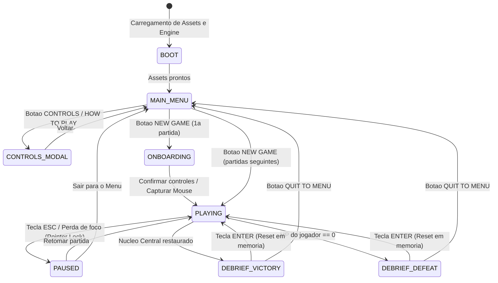
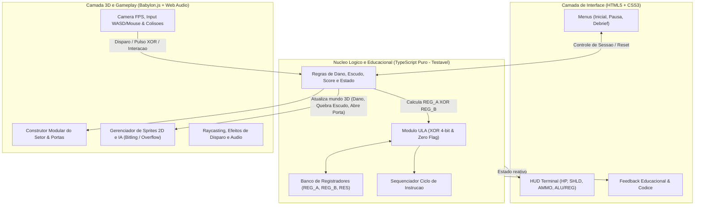
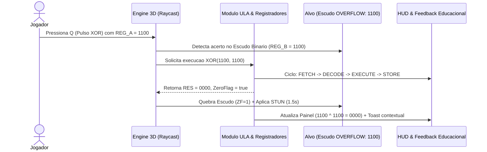
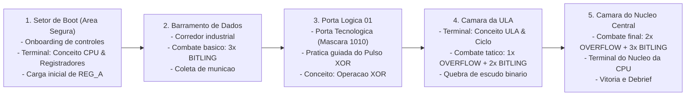

# Documento de Especificação de Requisitos (ERS & Game Design) — CORE BREACH

| Metadado | Descrição |
| :--- | :--- |
| **Projeto** | **CORE BREACH** |
| **Versão do Documento** | `1.0.0` (Escopo MVP) |
| **Data** | 29 de outubro de 2026 |
| **Categoria / Gênero** | Jogo Educacional — First-Person Shooter (FPS) Arcade Sci-Fi Retrô (anos 1990) |
| **Plataforma Alvo** | Navegador Web Desktop (Teclado + Mouse, sem instalação nativa) |
| **Stack Tecnológica** | TypeScript, Babylon.js (WebGL), HTML5 / CSS3 |
| **Documento Base** | [Briefing de Produto e Desenvolvimento](./BRIEFING.md) |

---

## Sumário

1. [Introdução e Escopo](#1-introdução-e-escopo)
2. [Visão Geral do Sistema, Estados e Controles](#2-visão-geral-do-sistema-estados-e-controles)
3. [Regras de Negócio e Mecânicas Computacionais (RN)](#3-regras-de-negócio-e-mecânicas-computacionais-rn)
4. [Requisitos Funcionais (RF)](#4-requisitos-funcionais-rf)
5. [Requisitos Educacionais e Matriz Pedagógica (RE)](#5-requisitos-educacionais-e-matriz-pedagógica-re)
6. [Especificação de Entidades e Parâmetros do MVP](#6-especificação-de-entidades-e-parâmetros-do-mvp)
7. [Requisitos Não Funcionais (RNF)](#7-requisitos-não-funcionais-rnf)
8. [Arquitetura Técnica e Design do Setor Único](#8-arquitetura-técnica-e-design-do-setor-único)
9. [Inventário e Requisitos de Assets (`/assets`)](#9-inventário-e-requisitos-de-assets-assets)
10. [Matriz de Rastreabilidade e Critérios Globais de Aceite](#10-matriz-de-rastreabilidade-e-critérios-globais-de-aceite)

---

## 1. Introdução e Escopo

### 1.1. Propósito deste Documento
Este documento formaliza os **Requisitos Funcionais (RF)**, **Requisitos Educacionais (RE)**, **Requisitos Não Funcionais (RNF)**, **Regras de Negócio (RN)** e **Critérios de Aceite** para o desenvolvimento do MVP (*Minimum Viable Product*) do jogo **CORE BREACH**. Ele serve como referência única tanto para engenharia de software e testes quanto para game design e validação pedagógica.

### 1.2. Visão do Produto
**CORE BREACH** coloca o jogador no papel de um programa de segurança operando dentro de um processador corrompido. Combinando a ação ágil dos FPS clássicos dos anos 1990 com fundamentos reais de **Arquitetura de Computadores**, o jogador explora setores internos do processador, combate processos defeituosos (**BITLING** e **OVERFLOW**), executa operações lógicas reais de **XOR** através da **ULA (ALU)** manipulando **Registradores** e vivencia o **Ciclo de Instrução** até restaurar o **Núcleo Central da CPU**.

### 1.3. Público-Alvo e Perfil de Uso
- **Público Primário:** Estudantes de graduação/técnico em Computação cursando Arquitetura e Organização de Computadores ou Introdução à Computação.
- **Público Secundário:** Entusiastas de tecnologia e jogos retrô interessados em aprender lógica digital de maneira prática.
- **Formato de Sessão:** Partidas rápidas de **3 a 5 minutos**, com curva de aprendizado imediata, controles clássicos de FPS para PC e reinício instantâneo.

### 1.4. Fronteiras do Escopo (MVP)

| Incluído no Escopo do MVP (v1.0) | Fora do Escopo do MVP (Backlog Futuro) |
| :--- | :--- |
| Menu inicial, tela de controles/como jogar e menu de pausa | Multiplayer local ou online |
| Setor tridimensional único com progressão até o Núcleo Central | Campanha multi-fases, mundo aberto ou geração procedural |
| Movimentação FPS (`WASD` + Mouse Look) e colisões básicas | Inventário complexo, árvore de habilidades ou criação de itens |
| Arma principal (`PULSE-9`), sistema de munição, vida, escudo e pontuação | Modelagem 3D complexa de personagens e animações esqueléticas |
| Habilidade **Pulso Lógico XOR** em tempo real com *cooldown* | Simulação completa de conjunto de instruções (ISA) de uma CPU real |
| Módulo real de lógica binária (4 bits), registradores e ciclo de instrução | Sistema de contas, login, banco de dados ou ranking em servidor |
| 2 arquétipos de inimigos em Sprites 2D (*billboard*): **BITLING** e **OVERFLOW** | Integração em tempo real com LLMs / IA generativa durante a partida |
| Portas tecnológicas / terminais interativos e feedback educacional contextual | Suporte nativo a dispositivos móveis (touchscreen) ou controles (gamepad) |
| Tela de resultado (*Debrief*) com métricas e reinício sem recarregar a página | Dublagem de voz ou *cutscenes* cinematográficas |

### 1.5. Glossário e Definições
- **CPU (*Central Processing Unit*):** Unidade Central de Processamento; ambiente macro do jogo cujo núcleo precisa ser estabilizado.
- **ULA / ALU (*Arithmetic Logic Unit*):** Circuito digital que realiza operações lógicas (como `XOR`) e aritméticas sobre dados vindos dos registradores.
- **Registrador (*Register*):** Memória de altíssima velocidade e baixa capacidade interna à CPU usada para armazenar operandos (`REG_A`, `REG_B`) e resultados (`RES`) de instruções.
- **XOR (*OU Exclusivo*):** Operação lógica bit a bit onde o resultado é `1` se e somente se os bits comparados forem diferentes (`0 XOR 0 = 0`, `0 XOR 1 = 1`, `1 XOR 0 = 1`, `1 XOR 1 = 0`).
- **Zero Flag (`ZF`):** Indicador de estado da ULA que assume valor `1` (verdadeiro) quando o resultado de uma operação é igual a zero (`0000`).
- **Ciclo de Instrução:** Sequência fundamental de processamento dividida didaticamente em 4 etapas: *Busca (Fetch)*, *Decodificação (Decode)*, *Execução (Execute)* e *Armazenamento (Writeback/Store)*.
- **Billboarding:** Técnica gráfica 3D dos FPS retrô onde um sprite 2D rotaciona no eixo vertical para permanecer sempre voltado para a câmera do jogador.

---

## 2. Visão Geral do Sistema, Estados e Controles

### 2.1. Máquina de Estados do Jogo
O sistema deve operar sob uma máquina de estados bem definida, garantindo que o reinício da partida limpe e reconstrua apenas o estado da sessão em memória, sem exigir recarregamento do navegador (`F5`).



### 2.2. Mapeamento Oficial de Controles (Desktop)

| Entrada | Ação no Jogo | Contexto |
| :--- | :--- | :--- |
| **`W`, `A`, `S`, `D`** | Movimentação horizontal (Frente, Esquerda, Trás, Direita) | Em partida (`PLAYING`) |
| **Movimento do Mouse** | Rotação da câmera (Yaw/Pitch) e mira central (*Pointer Lock API*) | Em partida (`PLAYING`) |
| **Botão Esquerdo do Mouse (`M1`)** | Disparo da arma principal (`PULSE-9`) | Em partida (`PLAYING`) |
| **Tecla `Q` ou Botão Direito (`M2`)** | Ativação do **Pulso Lógico XOR** (habilidade da ULA) | Em partida (`PLAYING`, sujeito a *cooldown*) |
| **Tecla `R` (ou Roda do Mouse)** | Alternar / ciclar máscara binária carregada no Registrador do Jogador (`REG_A`) | Em partida (`PLAYING`) |
| **Tecla `E`** | Interagir com Terminais de Dados, Portas Tecnológicas ou Núcleo Central | Em partida (próximo a objeto interativo) |
| **Tecla `Tab`** | Expandir / recolher painel de revisão rápida dos conceitos desbloqueados | Em partida / Pausa |
| **Tecla `Esc`** | Pausar o jogo, liberar o cursor do mouse e abrir menu de pausa | Em partida (`PLAYING` <-> `PAUSED`) |
| **Tecla `Enter`** | Reiniciar a partida imediatamente | Tela de Resultado (`DEBRIEF`) |

---

## 3. Regras de Negócio e Mecânicas Computacionais (RN)

### `RN-01` — Autenticidade Matemática da Operação XOR (4 bits)
Toda operação lógica exibida ou utilizada pelo jogo deve ser calculada por um módulo real de lógica binária operando sobre palavras de **4 bits** (*nibbles*, valores de `0000` a `1111` em binário / `0x0` a `0xF` em hexadecimal):
- Regra bit a bit para cada posição $i \in \{0, 1, 2, 3\}$:
  $$\text{RES}[i] = \text{REG\_A}[i] \oplus \text{REG\_B}[i]$$
- Exemplo obrigatório de verificação: `1010 XOR 1100 = 0110` (`0xA ^ 0xC = 0x6`).
- É estritamente proibido utilizar resultados pré-gravados meramente cosméticos desconectados dos operandos atuais.

### `RN-02` — Dinâmica do Pulso Lógico XOR em Tempo Real com Cooldown
A habilidade especial do jogador materializa o funcionamento da ULA em combate e exploração:
1. **Registrador Operando do Jogador (`REG_A`):** O jogador mantém um valor binário ativo de 4 bits no seu registrador `REG_A` (ex.: `1010`, `1100`, `1111`, `0101`), que pode ser carregado em terminais do cenário ou alternado rapidamente (`Tecla R` / *Scroll*) entre máscaras desbloqueadas no setor.
2. **Alvos Lógicos (`REG_B`):** O escudo defensivo do inimigo **OVERFLOW** e as travas de **Portas Tecnológicas** possuem um registrador de estado de 4 bits visível ao jogador (ex.: `1100`).
3. **Execução do Pulso (`Q` / `M2`):** Ao disparar o Pulso Lógico contra um alvo lógico dentro do alcance, a ULA executa `NOVO_ESTADO = REG_A XOR ESTADO_ALVO` e entra em **tempo de recarga (*cooldown*) de 3,0 segundos**.
4. **Resolução do Resultado:**
   - **Anulação Total (`NOVO_ESTADO == 0000`, `Zero Flag = 1`):** Demonstra a propriedade clássica de limpeza de registrador em Assembly (`X XOR X = 0`). O escudo do **OVERFLOW** sofre sobrecarga imediata (é destruído instantaneamente e atordoa o inimigo por `1,5s`), ou a **Porta Tecnológica** é destravada imediatamente.
   - **Mutação Parcial (`NOVO_ESTADO != 0000`, `Zero Flag = 0`):** O estado binário do escudo ou trava **é atualizado de verdade** para `NOVO_ESTADO` (ex.: escudo `1010` atingido por `REG_A = 1100` passa a exibir `0110` e perde integridade proporcional aos bits zerados). Isso garante que o jogador veja na prática a inversão seletiva de bits do XOR sem risco de travamento (*soft-lock*) da fase.

### `RN-03` — Regras de Vida, Escudo, Dano e Munição
1. **Atributos do Jogador:** Inicia com `100 HP` (vida máxima `100`) e `100 SHLD` (escudo inicial/máximo `100`, alinhado ao HUD).
2. **Absorção de Dano:** Ao receber dano, o escudo (`SHLD`) absorve o impacto primeiro na proporção `1:1`; apenas o dano excedente reduz o `HP`. Se `HP <= 0`, ocorre derrota imediata.
3. **Munição da Arma Principal (`PULSE-9`):** Inicia com `99 AMMO` (capacidade máxima `150`). Cada disparo consome `1 AMMO`. Inimigos derrotados e pacotes de dados no cenário restauram munição. Caso a munição chegue a `0`, um capacitor de emergência regenera `1 AMMO` a cada `1,5s` até `10 AMMO` para impedir *soft-lock* da partida.
4. **Interação Arma vs. Escudo Binário:** Enquanto o escudo binário de um **OVERFLOW** estiver ativo (`ESTADO != 0000`), disparos comuns da `PULSE-9` sofrem redução de `80%` de dano com feedback visual/sonoro de deflexão, incentivando o uso do **Pulso Lógico XOR**.

### `RN-04` — Representação do Ciclo de Instrução Simplificado
Sempre que o jogador executa uma operação na ULA (Pulso Lógico XOR ou ativação de Terminal/Núcleo), o módulo didático registra e destaca sequencialmente no painel superior do HUD (`CPU STATUS`) as 4 etapas:
1. **`FETCH` (Busca):** Leitura da instrução `XOR` e captura da máscara do alvo.
2. **`DECODE` (Decodificação):** Identificação da operação lógica na ULA e operandos `REG_A`, `REG_B`.
3. **`EXECUTE` (Execução):** Cálculo binário `REG_A XOR REG_B` na ULA.
4. **`STORE` (Armazenamento):** Gravação de `RES` no registrador de saída e aplicação do efeito no mundo 3D.

*Nota pedagógica:* A interface deve indicar explicitamente (nos cartões de conceito) que este fluxo de 4 etapas é um modelo didático simplificado do ciclo de instrução real.

### `RN-05` — Condições de Vitória, Derrota e Pontuação
- **Condição de Vitória:** Chegar à Câmara do Núcleo Central, eliminar as ameaças hostis da câmara e interagir com o terminal do Núcleo para executar a rotina de restauração.
- **Condição de Derrota:** `HP` do jogador atingir `0`.
- **Cálculo de Pontuação (`SCORE`):**
  - Eliminar **BITLING**: `+100 pts`
  - Eliminar **OVERFLOW**: `+300 pts`
  - Quebra Crítica de Escudo / Porta via XOR direto (`ZF = 1` no primeiro pulso): `+150 pts` (Bônus de Eficiência Lógica)
  - Desbloquear/Interagir com Conceito Educacional: `+100 pts`
  - Restaurar o Núcleo Central: `+500 pts`

### `RN-06` — Diretriz de Integração Pedagógica Não-Intrusiva
- Nenhuma mensagem educacional durante o combate pode bloquear os controles do jogador ou pausar a ação forçadamente.
- As mensagens contextuais em tela (*toasts* de terminal) devem ter no máximo **2 linhas curtas** (até ~140 caracteres), exibindo valores reais da operação recém-executada, ficando o texto aprofundado disponível sob demanda (`Tab` / Menu de Pausa / Tela de Debrief).

---

## 4. Requisitos Funcionais (RF)

> **Legenda de Prioridade (MoSCoW para o MVP):**
> - **Essencial (Must):** Indispensável para o MVP funcionar e validar a proposta.
> - **Importante (Should):** Agrega forte valor à experiência e clareza visual/pedagógica do MVP.
> - **Desejável (Could):** Polimento adicional caso o cronograma do MVP permita.

### 4.1. Fluxo de Telas, Menus e Sessão

| ID | Requisito | Descrição | Prioridade | Critérios de Aceite |
| :--- | :--- | :--- | :---: | :--- |
| **RF-01** | Menu Inicial | Exibir tela inicial com identidade visual retrô, logo **CORE BREACH** e opções `NEW GAME`, `CONTROLS` e `HOW TO PLAY`. | Essencial | 1. Ao abrir a URL no navegador, o menu carrega sem erros de console.<br>2. Todos os botões respondem a clique e navegação visual. |
| **RF-02** | Instruções Pré-Partida | Apresentar os controles básicos (`WASD`, Mouse, Disparo, Pulso XOR, Interação, Pausa) e o objetivo da missão antes do início da primeira partida. | Essencial | 1. Jogador visualiza o resumo de controles antes do primeiro combate.<br>2. Acessível também a qualquer momento via `CONTROLS` / `HOW TO PLAY` e menu de pausa. |
| **RF-03** | Sistema de Pausa | Permitir pausar e retomar a partida com `Esc` (ou automaticamente quando a aba/janela perder o *Pointer Lock*). | Essencial | 1. Ao pausar, movimentação de inimigos, projéteis, *cooldowns* e cronômetro são congelados.<br>2. Cursor do mouse fica livre para clicar em `RESUME`, `CONTROLS` ou `QUIT TO MENU`. |
| **RF-04** | Tela de Resultado (*Debrief*) e Reinício Rápido | Exibir ao fim da partida (Vitória ou Derrota) o status do sistema, `SCORE`, `ENEMIES DEFEATED [X/Y]`, `CPU CONCEPTS LEARNED [X/Y]`, `TIME ELAPSED` e opções de reiniciar (`Enter`) ou voltar ao menu. | Essencial | 1. Distingue claramente `SYSTEM RECOVERY: Successful` (Vitória) de `CRITICAL FAULT: System Halted` (Derrota).<br>2. Pressionar `Enter` reinicia a fase em `< 500ms` resetando vida, munição, inimigos, portas e registradores **sem recarregar a página HTML**. |

### 4.2. Câmera, Movimentação e Colisões 3D

| ID | Requisito | Descrição | Prioridade | Critérios de Aceite |
| :--- | :--- | :--- | :---: | :--- |
| **RF-05** | Câmera em Primeira Pessoa | Implementar câmera 3D perspectiva controlada por mouse utilizando a *Pointer Lock API* do navegador, com trava de ângulo vertical (*pitch* entre `-75°` e `+75°`). | Essencial | 1. Clicar na tela durante `PLAYING` captura o cursor.<br>2. A câmera gira suavemente sem inverter de cabeça para baixo ao olhar para cima/baixo. |
| **RF-06** | Movimentação `WASD` | Permitir deslocamento nas 4 direções relativas à orientação horizontal da câmera, com velocidade normalizada na diagonal e independente da taxa de quadros (*delta time*). | Essencial | 1. Mover na diagonal (`W+D`) não excede a velocidade máxima linear.<br>2. Resposta imediata sem inércia escorregadia excessiva (estilo FPS arcade anos 90). |
| **RF-07** | Colisão com Cenário e Limites | Impedir que o jogador atravesse paredes, portas trancadas, terminais, pilares ou saia dos limites do setor utilizando colisão por elipsoide/AABB do Babylon.js. | Essencial | 1. Deslizamento suave (*wall sliding*) ao caminhar encostado em paredes em ângulo.<br>2. Impossibilidade de sair para fora da geometria do mapa (*out of bounds*). |
| **RF-08** | Feedback de Movimento (*Weapon Bob*) | Aplicar oscilação sutil na sprite 2D da arma enquanto o jogador caminha, reforçando a estética dos FPS clássicos. | Desejável | 1. Oscilação ativa apenas durante deslocamento e cessa ao parar ou disparar. |

### 4.3. Combate e Arma Principal (`PULSE-9`)

| ID | Requisito | Descrição | Prioridade | Critérios de Aceite |
| :--- | :--- | :--- | :---: | :--- |
| **RF-09** | Renderização e Disparo da Arma Principal | Exibir a arma `PULSE-9` na parte inferior central da tela e disparar com `Botão Esquerdo do Mouse` respeitando cadência de tiro (*fire rate*) e munição disponível. | Essencial | 1. Disparo executa *raycast* (ou projétil de alta velocidade) a partir do centro da mira (`+`).<br>2. Cada tiro deduz `1 AMMO` e exibe o sprite de clarão de disparo (`animacao_disparo`). |
| **RF-10** | Detecção de Acerto e Dano | Detectar colisão do disparo contra *hitboxes* dos inimigos ou geometria do cenário, aplicando dano conforme `RN-03` e instanciando efeito de impacto (`impacto_disparo`). | Essencial | 1. Paredes bloqueiam disparos (não atravessam geometria sólida).<br>2. Acertar inimigo reduz seu HP, gera flash visual no sprite do inimigo e feedback na mira. |
| **RF-11** | Gestão de Vida, Escudo e Dano Recebido | Gerenciar `HP` e `SHLD` do jogador, aplicando feedback visual de dano (vinheta vermelha/laranja breve na borda da tela) ao ser atingido por inimigos. | Essencial | 1. Dano reduz `SHLD` antes de `HP`.<br>2. Quando `HP` chega a `0`, transição imediata para `DEBRIEF_DEFEAT`. |
| **RF-12** | Coletáveis de Reposição (*Pickups*) | Disponibilizar no cenário (ou ao derrotar inimigos) pacotes simples de restauração de Vida (`+25 HP`), Escudo (`+25 SHLD`) e Munição (`+20 AMMO`). | Importante | 1. Coleta automática ao passar sobre o item caso o atributo correspondente não esteja no máximo.<br>2. Feedback visual/sonoro curto na coleta. |

### 4.4. Habilidade Lógica XOR e Módulos Computacionais

| ID | Requisito | Descrição | Prioridade | Critérios de Aceite |
| :--- | :--- | :--- | :---: | :--- |
| **RF-13** | Motor Lógico da ULA (4 bits) | Implementar módulo independente em TypeScript para representar registradores de 4 bits, executar `XOR` bit a bit, converter entre binário (`1010`) e hexadecimal (`0xA`) e calcular flags (`ZF`). | Essencial | 1. Coberto por testes unitários automatizados para todas as combinações relevantes (incluindo `1010 XOR 1100 = 0110` e `X XOR X = 0000`).<br>2. Zero dependência de classes gráficas do Babylon.js. |
| **RF-14** | Seleção/Carga de Operando (`REG_A`) | Permitir ao jogador carregar valores binários no seu registrador `REG_A` através de terminais ou alternar entre máscaras disponíveis (`Tecla R` / *Scroll*), atualizando imediatamente o HUD. | Essencial | 1. O valor atual de `REG_A` está sempre visível em binário (4 bits) no HUD.<br>2. Trocar de operando emite feedback visual instantâneo no painel `ALU/REG`. |
| **RF-15** | Disparo do Pulso Lógico XOR com Cooldown | Permitir disparar o Pulso Lógico (`Tecla Q` ou `M2`) com *cooldown* de `3,0s`. Ao atingir um alvo com máscara binária (`OVERFLOW` ou `Porta Lógica`), executar `RN-02`. | Essencial | 1. Durante o *cooldown*, o ícone da habilidade exibe indicador visual de recarga e impede novo uso.<br>2. Acertar um escudo ou porta calcula o XOR real entre `REG_A` e a máscara do alvo, atualizando a máscara ou quebrando-a se resultado for `0000`. |
| **RF-16** | Inspeção de Alvo Binário na Mira | Ao apontar a mira central para um inimigo **OVERFLOW** escudado ou **Porta Lógica**, exibir próximo à mira/HUD a máscara atual do alvo (`REG_B`) e a prévia ou operação `REG_A XOR REG_B`. | Importante | 1. O estudante enxerga claramente os 4 bits do alvo antes de disparar o Pulso XOR. |
| **RF-17** | Rastreador do Ciclo de Instrução | Atualizar o indicador visual do Ciclo de Instrução (`FETCH -> DECODE -> EXECUTE -> STORE`) a cada execução da ULA, destacando as etapas em sequência rápida (ex.: `250ms` por etapa). | Importante | 1. As 4 etapas acendem em ordem cronológica correta sem travar o combate.<br>2. A última operação executada permanece registrada no painel da ULA (`ex.: 1010 ^ 1100 = 0110`). |

### 4.5. Inteligência Artificial e Inimigos

| ID | Requisito | Descrição | Prioridade | Critérios de Aceite |
| :--- | :--- | :--- | :---: | :--- |
| **RF-18** | Renderização de Inimigos em Sprite 2D (*Billboard*) | Renderizar os inimigos no espaço 3D usando sprites 2D com *billboarding* no eixo Y, mantendo nitidez pixel-art e escala coerente com a distância. | Essencial | 1. Sprites sempre encaram a câmera horizontalmente sem distorcer ao olhar de cima/baixo.<br>2. Transparência limpa ao redor da silhueta do inimigo. |
| **RF-19** | Máquina de Estados de IA (FSM) | Controlar inimigos por estados simples e previsíveis: `IDLE` (aguardando raio de detecção/linha de visão), `CHASE` (aproximação/posicionamento), `ATTACK` (execução de ataque), `STUNNED` (sobrecarga XOR) e `DEAD`. | Essencial | 1. Inimigos não atacam através de paredes fechadas.<br>2. Ao morrer, o inimigo exibe efeito de destruição, soma pontos e desativa sua *hitbox*. |
| **RF-20** | Comportamento do Inimigo **BITLING** | Implementar inimigo básico corpo a corpo (`inimigo.jpeg`): move-se diretamente em direção ao jogador ao detectá-lo e aplica dano de contato/curto alcance com intervalo entre ataques. | Essencial | 1. Velocidade moderada-alta, HP baixo, sem escudo binário.<br>2. Respeita distância mínima e *cooldown* de ataque melee para não drenar `100 HP` em um único frame. |
| **RF-21** | Comportamento do Inimigo **OVERFLOW** | Implementar inimigo avançado (`inimigo_longa_distancia.jpeg`): mantém distância média, dispara projéteis energéticos visíveis (desviáveis lateralmente) e possui **Escudo Binário de 4 bits** frontal. | Essencial | 1. Projétil do OVERFLOW tem velocidade legível permitindo esquiva com `A`/`D`.<br>2. Enquanto o escudo binário (`!= 0000`) estiver ativo, exibe aura/indicador ciano e mitiga disparos comuns (`RN-03`).<br>3. Ao ter o escudo zerado (`0000`) via Pulso XOR, entra em `STUNNED` por `1,5s` e fica totalmente vulnerável à `PULSE-9`. |

### 4.6. Cenário, Interação e Progressão

| ID | Requisito | Descrição | Prioridade | Critérios de Aceite |
| :--- | :--- | :--- | :---: | :--- |
| **RF-22** | Construção Modular do Setor Único | Construir um mapa 3D único dividido em salas temáticas conectadas (Área Segura de Boot -> Barramento de Dados -> Sala da ULA -> Porta Lógica de Segurança -> Câmara do Núcleo Central) usando módulos reutilizáveis de piso, parede e teto. | Essencial | 1. Percurso completo jogável em 3 a 5 minutos.<br>2. Iluminação e cores orientam naturalmente o caminho até o Núcleo. |
| **RF-23** | Portas Tecnológicas e Travas Lógicas | Implementar portas deslizantes (`porta_tecnologica.jpeg`) que bloqueiam o avanço e abrem por limpeza de ameaças da sala, interação em terminal (`E`) ou resolução de trava binária com Pulso Lógico XOR (`0000`). | Essencial | 1. Porta exibe estado visual claro (Trancada em laranja `#FF9D36` + máscara binária / Destrancada em verde `#39FF88`).<br>2. Colisão é desativada suavemente quando a porta desliza/abre. |
| **RF-24** | Terminais Computacionais Interativos | Dispor terminais nas áreas-chave (Registradores, ULA, Ciclo de Instrução, Núcleo) que, ao pressionar `E` (ou aproximar-se), carregam máscaras de registrador e disparam pílulas educacionais contextuais. | Importante | 1. Prompt visual `[E] ACCESS TERMINAL` aparece ao se aproximar a `< 2,5m` olhando para o terminal.<br>2. Interação registra o conceito como aprendido para o contador do Debrief. |
| **RF-25** | Evento de Restauração do Núcleo Central | Na sala final (`cenario_final.jpeg`), após derrotar os guardiões finais (combinação de BITLINGs e OVERFLOW), habilitar o terminal do Núcleo Central para estabilizar a CPU e vencer a partida. | Essencial | 1. Indicador de distância/objetivo no topo do HUD (`< CORE BREACH: Xm`) guia o jogador até o Núcleo.<br>2. Ativar o Núcleo aciona feedback luminoso/sonoro de restauração e abre a tela `DEBRIEF_VICTORY`. |

### 4.7. Interface (HUD), Feedback Educacional e Áudio

| ID | Requisito | Descrição | Prioridade | Critérios de Aceite |
| :--- | :--- | :--- | :---: | :--- |
| **RF-26** | HUD Minimalista Estilo Terminal | Implementar camada HTML/CSS sobre o canvas 3D contendo: `HP` e `SHLD` (canto inferior esquerdo), `AMMO` e nome da arma `PULSE-9` (canto inferior direito), Mira central `+`, Objetivo/Distância e Pontuação (topo centro), e Painel `CPU STATUS / ALU / REG` (topo esquerdo/direito). | Essencial | 1. Layout fiel à referência visual `assets/HUD.jpeg` e à paleta oficial.<br>2. Atualização reativa imediata sempre que qualquer estado do jogo mudar. |
| **RF-27** | Feedback Educacional Contextual (*Terminal Toast*) | Exibir notificações curtas e estilizadas quando o jogador encontra pela primeira vez um componente da CPU ou executa uma operação XOR, diferenciadas visualmente dos alertas de combate. | Essencial | 1. Mensagens curtas, sem pausar o jogo, com desaparecimento automático suave após `5–6s`.<br>2. Não repete insistentemente a mesma explicação já exibida na mesma partida. |
| **RF-28** | Códice / Revisão Pós-Combate de Conceitos | Permitir ao jogador revisar explicações um pouco mais detalhadas dos conceitos encontrados pressionando `Tab` / acessando a aba `CPU CONCEPTS` no menu de Pausa e na tela de Debrief. | Importante | 1. Lista os 5 conceitos do MVP (CPU, ULA, Registradores, Operação XOR, Ciclo de Instrução) com status bloqueado/aprendido e exemplo prático. |
| **RF-29** | Efeitos Sonoros Básicos (SFX) | Reproduzir efeitos sonoros retrô leves (via *Web Audio API* procedural ou arquivos `.ogg`/`.wav` curtos) para: disparo `PULSE-9`, Pulso XOR, impacto/deflexão em escudo, quebra de escudo (`ZF=1`), dano recebido, abertura de porta e vitória/derrota. | Importante | 1. Sons respeitam a política de *autoplay* dos navegadores (inicializados após o primeiro clique no menu).<br>2. Opção simples de silenciar áudio (*Mute*) no menu/pausa. |

---

## 5. Requisitos Educacionais e Matriz Pedagógica (RE)

Os requisitos educacionais asseguram que cada elemento técnico de Arquitetura de Computadores exigido pelo briefing esteja ancorado em uma experiência concreta e conceitualmente correta.

| ID | Conceito | Representação no Jogo | Interação do Jogador | Feedback Curto em Partida (*Toast*) | Resumo no Códice / Revisão (`Tab` / Debrief) |
| :--- | :--- | :--- | :--- | :--- | :--- |
| **RE-01** | **CPU** (*Unidade Central de Processamento*) | Todo o complexo industrial do setor e a grande Câmara do Núcleo Central (`cenario_final.jpeg`). | Explorar os corredores de barramento, eliminar processos corrompidos e reativar o Núcleo Central. | `[CPU] Setor Central identificado: a CPU coordena componentes e executa instruções do sistema.` | Explica o papel da CPU como cérebro executivo do computador, integrando Unidade de Controle, ULA e Registradores. |
| **RE-02** | **Registradores** (*Registers*) | Terminais de dados rápidos e os slots `REG_A`, `REG_B` e `RES` exibidos no painel superior do HUD. | Carregar/alternar máscaras binárias de 4 bits (`Tecla R` / Terminais) para preparar disparos lógicos. | `[REG] Registrador carregado (1100): memória ultrarrápida interna à CPU para operandos ativos.` | Destaca que registradores ficam dentro do processador e guardam temporariamente os bits que a ULA vai operar imediatamente. |
| **RE-03** | **ULA / ALU** (*Unidade Lógica e Aritmética*) | Câmara da ULA no meio do setor e o módulo da habilidade especial acoplado ao programa de segurança. | Disparar o Pulso Lógico contra travas e escudos, observando entradas e saída no painel `ALU: ACTV`. | `[ULA] Operação executada na ULA: circuito responsável pelos cálculos aritméticos e lógicos.` | Explica como a ULA recebe operandos dos registradores, aplica portas lógicas/somadores e gera um resultado mais flags de estado (como a *Zero Flag*). |
| **RE-04** | **Operação Lógica XOR** (*OU Exclusivo*) | Habilidade **Pulso Lógico XOR** interagindo com máscaras de 4 bits em Portas Lógicas e escudos do **OVERFLOW**. | Comparar seu `REG_A` com a máscara do escudo/porta; aplicar `X XOR X = 0000` para anulação instantânea ou observar inversão seletiva de bits. | `[XOR] 1010 XOR 1100 = 0110 -> Bits iguais geram 0; bits diferentes geram 1.` (ou `[ZF=1] 1100 XOR 1100 = 0000 -> Registrador zerado!`) | Apresenta a tabela-verdade do XOR e explica suas duas aplicações reais clássicas: inversão seletiva de máscaras de bits e limpeza rápida de registradores (`XOR R1, R1`). |
| **RE-05** | **Ciclo de Instrução** (*Fetch-Decode-Execute-Store*) | Sequenciador luminoso de 4 estágios no HUD `CPU STATUS` e nos painéis da Câmara da ULA / Núcleo. | Acionar o Pulso Lógico ou terminal de instrução e observar os 4 estágios acenderem em cadeia até aplicar o efeito. | `[CICLO] Busca -> Decodificação -> Execução -> Armazenamento concluídos com sucesso.` | Esclarece as 4 fases fundamentais pelas quais uma instrução passa (explicitando tratar-se de um modelo didático simplificado sem *pipeline* superescalar). |

---

## 6. Especificação de Entidades e Parâmetros do MVP

> [!NOTE]
> Os valores numéricos abaixo definem a linha de base (*baseline*) para implementação inicial e devem ser centralizados em um arquivo de configuração (`config/balance.ts`) para facilitar ajustes durante testes com jogadores.

### 6.1. Jogador e Equipamento
| Parâmetro | Valor Inicial (Baseline) | Observação |
| :--- | :--- | :--- |
| Vida (`HP`) | `100` (Máx: `100`) | Derrota ao atingir `0` |
| Escudo (`SHLD`) | `100` (Máx: `100`) | Absorve dano antes do `HP` |
| Velocidade de Movimento | `7,5 unidades/s` | Movimentação ágil estilo arcade |
| Arma Principal (`PULSE-9`) | Dano: `20` \| Cadência: `4 tiros/s` | Munição inicial: `99` (Máx: `150`) |
| Pulso Lógico (`XOR`) | Cooldown: `3,0s` \| Alcance: `25m` | Aplica `REG_A XOR MASK_ALVO`; atordoa `OVERFLOW` por `1,5s` se resultado `== 0000` |

### 6.2. Inimigos do MVP
| Atributo | **BITLING** (`assets/inimigo.jpeg`) | **OVERFLOW** (`assets/inimigo_longa_distancia.jpeg`) |
| :--- | :--- | :--- |
| **Papel Tático** | Pressão rápida corpo a corpo; ensina mira e movimentação | Inimigo tático à distância; incentiva leitura binária e uso do Pulso XOR |
| **Vida (`HP`)** | `40 HP` (2 disparos de `PULSE-9`) | `100 HP` (5 disparos de `PULSE-9` após queda do escudo) |
| **Defesa / Escudo** | Nenhum | **Escudo Binário de 4 bits** (ex.: `1010`, `1100`, `1111`); reduz `80%` do dano balístico enquanto `!= 0000` |
| **Tipo de Ataque** | Contato / Garra energética (Alcance `1,8m`) | Disparo de plasma à distância (Alcance `20m`, projétil a `14 unidades/s`) |
| **Dano por Ataque** | `12` (Intervalo: `1,0s`) | `18` (Intervalo: `1,8s`) |
| **Velocidade** | `5,5 unidades/s` | `2,5 unidades/s` |
| **Pontuação** | `100 pts` | `300 pts` (`+150 pts` se escudo anulado com `ZF = 1`) |

---

## 7. Requisitos Não Funcionais (RNF)

| ID | Categoria | Especificação | Métrica / Verificação |
| :--- | :--- | :--- | :--- |
| **RNF-01** | **Desempenho** | O jogo deve manter execução fluida em computadores desktop/notebooks convencionais (mesmo com vídeo integrado moderno) usando WebGL2/WebGL1. | Taxa alvo de **60 FPS** (mínimo aceitável de **30 FPS** constantes em `1280x720` ou `1920x1080`). |
| **RNF-02** | **Portabilidade e Compatibilidade** | Execução 100% no navegador desktop sem plugins externos ou instalação nativa. | Compatível com versões atuais do Google Chrome, Mozilla Firefox, Microsoft Edge e Safari Desktop. |
| **RNF-03** | **Carregamento e Reinício** | O pacote inicial deve ser leve e o reinício da partida não deve recarregar a página inteira. | Boot inicial local/banda larga `< 3 segundos`; reinício via `DEBRIEF` `< 500ms` sem `location.reload()`. |
| **RNF-04** | **Modularidade e Testabilidade** | Desacoplamento estrito entre a **lógica computacional/regras de jogo** (`src/core/`) e a **camada de renderização 3D / DOM** (`src/engine/`, `src/ui/`). | `100%` das funções de ULA (`XOR`), registradores, flags e ciclo de instrução testáveis via suíte de testes unitários (ex.: Vitest) em Node.js sem instanciar `BABYLON.Engine`. |
| **RNF-05** | **Identidade Visual e Paleta** | Fidelidade rigorosa à direção sci-fi retrô anos 90 e à paleta oficial: Metal escuro (`#101820`), Verde terminal (`#39FF88`), Ciano elétrico (`#00D9FF`) e Laranja de alerta (`#FF9D36`). | Texturas e sprites renderizados com amostragem `NEAREST_SAMPLINGMODE` no Babylon.js para preservar estética pixel-art nítida (sem borrão bilinear) e tipografia monoespaçada na UI. |
| **RNF-06** | **Usabilidade e Autossuficiência** | Um novo jogador deve conseguir iniciar, entender os controles, usar o Pulso XOR e concluir o setor sem auxílio de um instrutor externo. | Sessão completa contida entre **3 e 5 minutos**; instruções visíveis no fluxo inicial e dicas contextuais em portas/escudos. |
| **RNF-07** | **Padronização do Pipeline de Assets** | Sprites 2D de inimigos, arma, ícones e efeitos de disparo/impacto devem possuir canal de transparência real (`Alpha / RGBA` em `.png` ou `.webp`). | Pré-processamento obrigatório dos arquivos de sprite em `assets/` que atualmente estão em `.jpeg` com fundo quadriculado opaco, gerando versões `.png` transparentes otimizadas. |
| **RNF-08** | **Manutenibilidade do Código** | Código escrito em TypeScript com tipagem estrita (`strict: true`), responsabilidades claras e sem abstrações excessivas (*over-engineering*). | Compilação limpa (`tsc --noEmit`) sem erros de tipo e organização modular direta. |

---

## 8. Arquitetura Técnica e Design do Setor Único

### 8.1. Arquitetura em Camadas e Fluxo do Pulso XOR
A arquitetura separa o domínio lógico-educacional da camada visual 3D (Babylon.js) e da interface (HTML/CSS), comunicando eventos de forma limpa:



#### Sequência de Execução de um Pulso Lógico XOR (`sequenceDiagram`)


### 8.2. Estrutura de Diretórios Sugerida (Vite + TypeScript + Babylon.js)
```text
CoreBreach/
├── assets/                  # Recursos visuais originais e processados (.png / .jpeg)
├── docs/
│   ├── BRIEFING.md
│   └── DOCUMENTO_DE_REQUISITOS.md
├── src/
│   ├── config/
│   │   └── balance.ts       # Constantes de vida, dano, cooldowns, paleta e textos pedagógicos
│   ├── core/                # TypeScript puro (0 dependências de Babylon.js / DOM)
│   │   ├── alu.ts           # Operação XOR real de 4 bits, conversão bin/hex e flags
│   │   ├── registers.ts     # Estado dos registradores REG_A, REG_B e RES
│   │   ├── instructionCycle.ts # Máquina de 4 estágios (Fetch, Decode, Execute, Store)
│   │   ├── combat.ts        # Regras de dano, absorção de escudo e pontuação
│   │   └── education.ts     # Gatilhos e catálogo de conceitos aprendidos
│   ├── game/                # Integração Babylon.js e entidades 3D/2D
│   │   ├── GameSession.ts   # Ciclo de vida da partida e reset sem reload
│   │   ├── PlayerController.ts # Câmera FPS, Pointer Lock, WASD e colisões
│   │   ├── WeaponSystem.ts  # PULSE-9, Pulso Lógico XOR e Raycasting
│   │   ├── LevelBuilder.ts  # Montagem modular do setor, portas e terminais
│   │   └── enemies/         # FSM, Bitling.ts e Overflow.ts (Sprites 2D Billboard)
│   ├── ui/                  # Controladores de interface HTML/CSS
│   │   ├── HudRenderer.ts
│   │   ├── MenuController.ts
│   │   └── ToastManager.ts
│   ├── audio/
│   │   └── SoundEffects.ts  # Sintetizador retrô leve via Web Audio API
│   └── main.ts              # Ponto de entrada da aplicação
└── tests/
    └── alu.test.ts          # Testes unitários verificando matemática binária e regras
```

### 8.3. Mapa de Progressão do Setor Único (MVP — 3 a 5 minutos)



---

## 9. Inventário e Requisitos de Assets (`/assets`)

Durante o levantamento de requisitos, foram identificados **18 arquivos visuais** já criados na pasta [`assets/`](../assets/) do projeto. A tabela abaixo mapeia o papel de cada recurso nos requisitos e especifica o tratamento técnico necessário para integração no Babylon.js / HTML.

| Arquivo em `assets/` | Uso no Sistema (Requisito Associado) | Status / Tratamento Técnico Necessário (`RNF-07`) |
| :--- | :--- | :--- |
| [`logo_core_breach.jpeg`](../assets/logo_core_breach.jpeg) / [`logo_corebreach.jpeg`](../assets/logo_corebreach.jpeg) | Identidade visual do Menu Inicial (`RF-01`) | Selecionar versão principal e converter fundo para `.png` transparente. |
| [`tela_inicial.jpeg`](../assets/tela_inicial.jpeg) | Mockup de referência visual e *background* do Menu Inicial (`RF-01`) | Usar como referência fiel de UI HTML/CSS (botões interativos reais sobre fundo estilizado). |
| [`HUD.jpeg`](../assets/HUD.jpeg) | Mockup diretor do layout do HUD (`RF-26`) | Referência de design para implementar os painéis `CPU STATUS`, `HP/SHLD`, `AMMO/PULSE-9` e mira `+` em HTML/CSS dinâmico. |
| [`tela_vitoria_derrota.jpeg`](../assets/tela_vitoria_derrota.jpeg) | Mockup diretor da tela de *Debrief* (`RF-04`) | Referência fiel para implementar os campos dinâmicos (`SCORE`, `ENEMIES`, `CPU CONCEPTS`, `TIME`) e botão/atalho `ENTER`. |
| [`textura_parede.jpeg`](../assets/textura_parede.jpeg) | Textura modular das paredes 3D do setor (`RF-22`) | Ajustar repetição UV (*seamless tiling*) e aplicar `NEAREST_SAMPLINGMODE`. |
| [`texxtura_chao.jpeg`](../assets/texxtura_chao.jpeg) | Textura modular do piso e teto 3D (`RF-22`) | Padronizar nome no pipeline (ou mapear caminho exato) e aplicar *tiling* UV. |
| [`porta_tecnologica.jpeg`](../assets/porta_tecnologica.jpeg) | Textura da malha 3D das Portas Lógicas (`RF-23`) | Recortar área útil do portal metálico para aplicação na *mesh* deslizante da porta. |
| [`cenario.jpeg`](../assets/cenario.jpeg) / [`cenario_final.jpeg`](../assets/cenario_final.jpeg) | Concept art dos corredores e textura/painel focal do Núcleo Central (`RF-22`, `RF-25`) | `cenario_final.jpeg` fornece a arte visual do grande chip ciano/laranja do Núcleo Central da CPU. |
| [`arma_principal_jogo.jpeg`](../assets/arma_principal_jogo.jpeg) | Sprite da arma `PULSE-9` (`RF-09`, `RF-12`) | **Requer pré-processamento:** remover padrão quadriculado embutido no JPEG -> exportar `.png` com transparência alpha. |
| [`inimigo.jpeg`](../assets/inimigo.jpeg) | Sprite 2D (*Billboard*) do inimigo **BITLING** (`RF-18`, `RF-20`) | **Requer pré-processamento:** remover padrão quadriculado do JPEG -> exportar `.png` com transparência alpha. |
| [`inimigo_longa_distancia.jpeg`](../assets/inimigo_longa_distancia.jpeg) | Sprite 2D (*Billboard*) do inimigo **OVERFLOW** (`RF-18`, `RF-21`) | **Requer pré-processamento:** remover padrão quadriculado do JPEG -> exportar `.png` com transparência alpha. |
| [`animacao_disparo.jpeg`](../assets/animacao_disparo.jpeg) | Sprite de *muzzle flash* (clarão de disparo) (`RF-09`) | **Requer pré-processamento:** converter para `.png` transparente (ou *blend mode* aditivo). |
| [`impacto_disparo.jpeg`](../assets/impacto_disparo.jpeg) | Sprite de impacto de projétil / destruição (`RF-10`) | **Requer pré-processamento:** converter para `.png` transparente. |
| [`icones.jpeg`](../assets/icones.jpeg) | Folha de ícones pixel-art: Vida, Escudo, Munição, Pulso Lógico (Raio), Chip CPU Corrompido e Alerta (`RF-26`, `RF-12`) | **Requer pré-processamento:** fatiar (*slice*) os 6 ícones individuais em `.png` com fundo transparente para HUD e *pickups* 3D. |

---

## 10. Matriz de Rastreabilidade e Critérios Globais de Aceite

### 10.1. Matriz de Rastreabilidade (Objetivos do Briefing x Requisitos)

| Objetivo Específico do Briefing (Seção 3.2) | Requisitos Funcionais | Requisitos Educacionais / Regras | Requisitos Não Funcionais |
| :--- | :--- | :--- | :--- |
| Experiência simples de iniciar e fácil de compreender | `RF-01`, `RF-02`, `RF-26` | `RN-06` | `RNF-02`, `RNF-03`, `RNF-06` |
| Movimentação em 1ª pessoa, combate e interação com cenário | `RF-05` a `RF-12`, `RF-22` a `RF-25` | `RN-03`, `RN-05` | `RNF-01`, `RNF-05` |
| Representar visualmente componentes computacionais | `RF-17`, `RF-22` a `RF-26` | `RE-01`, `RE-02`, `RE-03` | `RNF-05`, `RNF-07` |
| Introduzir CPU, ULA, registradores e ciclo de instrução | `RF-14`, `RF-17`, `RF-24`, `RF-27`, `RF-28` | `RE-01` a `RE-05`, `RN-04` | `RNF-06` |
| Operações lógicas em mecânicas com resultados verificáveis | `RF-13` a `RF-16`, `RF-21`, `RF-23` | `RN-01`, `RN-02`, `RE-04` | `RNF-04` |
| Feedback educacional curto, contextualizado e aprofundável | `RF-27`, `RF-28` | `RN-06`, `RE-01` a `RE-05` | `RNF-05`, `RNF-06` |
| Projeto tecnicamente simples, modular e testável | `RF-13`, `RF-18`, `RF-19` | `RN-01` | `RNF-04`, `RNF-07`, `RNF-08` |
| Reiniciar a partida rapidamente para consolidar aprendizado | `RF-03`, `RF-04` | `RN-05` | `RNF-03` |

### 10.2. Checklist de Validação Final do MVP (Definition of Done)

Para que a versão `1.0 (MVP)` do **CORE BREACH** seja considerada aprovada, todos os itens abaixo devem ser verificados positivamente:

- [ ] **Autonomia do Jogador:** Um estudante consegue abrir o jogo no navegador, compreender os controles pela interface inicial e concluir o setor até o Núcleo Central sem instruções verbais externas.
- [ ] **Consistência de Controles e Física:** Movimentação `WASD` + Mouse Look responsiva, sem atravessar paredes, portas trancadas ou cair para fora do cenário.
- [ ] **Clareza de Combate:** Disparos da `PULSE-9` apresentam clarão, impacto, som, redução de munição e feedback nítido de dano nos inimigos **BITLING** e **OVERFLOW**.
- [ ] **Verificabilidade Matemática do XOR:** Testes unitários automatizados comprovam `100%` de exatidão na operação XOR de 4 bits (ex.: `1010 XOR 1100 = 0110` e `1100 XOR 1100 = 0000` com `ZF = 1`), e o mesmo módulo alimenta os escudos, portas e registradores do HUD em tempo real.
- [ ] **Integração Tática da Habilidade Lógica:** O escudo binário do **OVERFLOW** e a **Porta Lógica** reagem fielmente ao Pulso Lógico XOR com *cooldown* funcional.
- [ ] **Aprendizagem Contextualizada:** Os 5 conceitos-chave (*CPU*, *ULA/ALU*, *Registradores*, *Porta Lógica XOR* e *Ciclo de Instrução*) são apresentados durante a partida de forma curta e podem ser revisados no menu/debrief.
- [ ] **Ciclo Completo de Partida e Reinício Limpo:** Tanto a restauração do Núcleo (Vitória) quanto `HP == 0` (Derrota) levam à tela de *Debrief* com métricas precisas, e pressionar `Enter` reinicia a partida limpa sem recarregar a página do navegador.
- [ ] **Performance e Estética:** Execução fluida (`>= 30-60 FPS`) em navegador desktop moderno com visual retrô fiel à paleta oficial e sprites com transparência tratada.
