# Auditoria Técnica, Migração 3D -> 2D Top-Down 3/4, Guia de Modelos e Pipeline Visual (`agent-sprite-forge`)

**Projeto:** CORE BREACH (*Breach Core*)  
**Data da Atualização:** 30 de outubro de 2026  
**Versão Alvo:** `v2.0.0-2d`  
**Escopo:** Resolução integral dos débitos técnicos da auditoria pós-MVP (`DT-01` a `DT-12`), **migração completa de FPS 3D (`Babylon.js`) para Top-Down 2D 3/4 Tático (`Canvas2D` Pixel-Perfect + Fog of War)**, guia de seleção de modelos de IA por tarefa (Custo-Benefício x Qualidade) e produção de assets pixel-art com `0x0funky/agent-sprite-forge`.

---

## Sumário

1. [Resumo Executivo da Auditoria e Decisão de Migração 2D](#1-resumo-executivo-da-auditoria-e-decisão-de-migração-2d)
2. [Matriz Completa de Débito Técnico e Transformação 2D](#2-matriz-completa-de-débito-técnico-e-transformação-2d)
3. [Guia de Modelos por Tarefa (Custo-Benefício x Qualidade)](#3-guia-de-modelos-por-tarefa-custo-benefício-x-qualidade)
4. [Arquitetura Alvo 2D Top-Down 3/4 + Fog of War](#4-arquitetura-alvo-2d-top-down-34--fog-of-war)
5. [Diagnóstico do Ambiente `agent-sprite-forge`](#5-diagnóstico-do-ambiente-agent-sprite-forge)
6. [Passo a Passo de Execução (Roteiro Técnico Passos 1 -> 8)](#6-passo-a-passo-de-execução-roteiro-técnico-passos-1---8)
   - [Passo 1 (Blocker): `SpatialCollisionIndex` — Colisão Dinâmica de Portas e Raycasting 2D Unificado](#passo-1-blocker-spatialcollisionindex--colisão-dinâmica-de-portas-e-raycasting-2d-unificado)
   - [Passo 2 (Blocker): Solubilidade Algébrica em GF(2) e Correção do HUD (`REG_A` / `TARGET`)](#passo-2-blocker-solubilidade-algébrica-em-gf2-e-correção-do-hud-reg_a--target)
   - [Passo 3 (Blocker): Fim do Deadlock de Pausa, Modais Faltantes e Mira 2D por Cursor Livre](#passo-3-blocker-fim-do-deadlock-de-pausa-modais-faltantes-e-mira-2d-por-cursor-livre)
   - [Passo 4 (Crítica): Refatoração da God Closure (`main.ts` -> `GameSession` + `IEcsSystem`) e `Camera2D`](#passo-4-crítica-refatoração-da-god-closure-maints---gamesession--iecssystem-e-camera2d)
   - [Passo 5 (Crítica): Projéteis Reais do `OVERFLOW` (`14 u/s`) e Regras Estritas do Bônus `ZF=1`](#passo-5-crítica-projéteis-reais-do-overflow-14-us-e-regras-estritas-do-bônus-zf1)
   - [Passo 6 (Migração 2D): Remoção do Babylon.js e Novo `Canvas2dRenderAdapter` + Fog of War 2D](#passo-6-migração-2d-remoção-do-babylonjs-e-novo-canvas2drenderadapter--fog-of-war-2d)
   - [Passo 7 (Visual 2D): Produção de Sprites 3/4, Protagonista, Tileset e VFX com `agent-sprite-forge`](#passo-7-visual-2d-produção-de-sprites-34-protagonista-tileset-e-vfx-com-agent-sprite-forge)
   - [Passo 8 (Qualidade): Testes Vitest, Playwright E2E 2D e Fechamento do Memory Bank](#passo-8-qualidade-testes-vitest-playwright-e2e-2d-e-fechamento-do-memory-bank)

---

## 1. Resumo Executivo da Auditoria e Decisão de Migração 2D

Graças à separação estrita em **Clean Architecture + Hybrid ECS** (`ADR-001` e `ADR-002`), **100% da camada de Domínio (`src/domain/`) já opera em coordenadas 2D puras `(x, z)`** — incluindo `AluEngine` (XOR 4 bits), `RegisterBank`, `InstructionCycleTracker`, `Vec2`, `CollisionMath`, `DdaRaycaster` e o mapa `MvpSectorBlueprint` (grid 12x36 de 5 câmaras).

A decisão estratégica de **transformar o jogo em Top-Down 2D 3/4 com Fog of War e Canvas 2D Nativo** resolve na raiz os maiores gargalos encontrados na auditoria 3D e alinha o runtime diretamente aos conceitos originais em `assets/` (como `Ficha do Protagonista Core Breach.png` e `texxtura_chao.jpeg`) e às skills do `agent-sprite-forge`:

### 1.1. Problemas Críticos Diagnosticados no Estado Atual (`v1.0.0-mvp`)
1. **Qualidade de Código (SOLID & DRY):**
   - *God Closure* de 225 linhas em `src/main.ts`;
   - 9 sistemas ECS estáticos sem contrato `IEcsSystem` (`LogicalPulseSystem.update` recebe 11 parâmetros);
   - Triplicação literal da matemática de raycast raio-círculo em `WeaponSystem`, `LogicalPulseSystem` e `TargetInspectionSystem`.
2. **Arquitetura (Clean Architecture & DIP):**
   - Violação ascendente `src/ecs/systems/* -> @app/ports/*` não capturada por `tests/architecture/boundaries.test.ts`;
   - `TargetInspectionSystem` chama `registerBank.storeOperation()` apenas ao passar a mira sobre um alvo, corrompendo o histórico `RES` da ULA.
3. **Performance (VRAM, Bundle & Game Loop):**
   - `BabylonRenderAdapter` pesava **~5 MB** no bundle, gerava ~280 *draw calls* estáticos e vazava `StandardMaterial` na VRAM a cada tiro (`setTimeout`) e morte de inimigo;
   - `World.query()` aloca 480 arrays/segundo sem cache e `main.ts` inunda o `EventBus` com 180 atualizações de DOM/segundo sem mudança de estado.
   - **Impacto da Migração 2D:** A substituição do `@babylonjs/core` por um `Canvas2dRenderAdapter` com *Offscreen Tilemap Buffer* elimina os ~5 MB de dependência 3D, zera 100% dos vazamentos de `StandardMaterial` na GPU e reduz o render do cenário estático a **1 único `ctx.drawImage()` por frame**.
4. **UX e Mecânicas (Game Feel, Álgebra Booleana & Controles):**
   - **Deadlock de Pausa:** `Esc` entrava em `GameState.PAUSED` sem modal e sem botão/handler de retorno (`F5` obrigatório); `btnControls` e `Tab` (Códice) desconectados;
   - **Portas Fantasmas:** `CellType.DOOR` era ignorado na colisão física e linha de visão (LoS);
   - **Escudo `1111` Insolúvel em $\mathbb{F}_2^4$:** Com apenas `{1010, 1100}` em `REG_A`, $\text{span}\{1010, 1100\} = \{0000, 1010, 1100, 0110\}$, tornando impossível zerar o `OVERFLOW` `1111` da câmara final;
   - **Congelamento de `REG_A` no HUD:** `#hudRegStatus` travava após o 1º XOR devido à checagem `!textContent.includes('^')`;
   - **Fim da Fricção de Pointer Lock no 2D:** Em Top-Down 2D, o mouse não precisa mais ser sequestrado pelo navegador (`Pointer Lock`); o cursor move uma mira tática pixel-art livremente em 360° pelo canvas, tornando `Esc` (Pausa) instantâneo e livre de *race conditions* do navegador.

---

## 2. Matriz Completa de Débito Técnico e Transformação 2D

| ID | Componente | Problema / Transformação | Solução Técnica | Prioridade | Esforço |
| :---: | :--- | :--- | :--- | :---: | :---: |
| **DT-01** | `SpatialCollisionIndex` / Portas | Portas Lógicas (`CellType.DOOR`) não bloqueiam colisão, tiros, LoS nem Fog of War. | Criar `SpatialCollisionIndex` rastreando células de portas sólidas (`slideProgress < 0.8`). | **Blocker** | Baixo |
| **DT-02** | `UiRootController` / `index.html` | Deadlock em `PAUSED`; modais de Pausa, Controles, Onboarding e Códice (`Tab`) ausentes. | Implementar os 4 modais HTML/CSS e `UiRootController` reativo a `GAME_STATE_CHANGED`. | **Blocker** | Médio |
| **DT-03** | `MvpSectorBlueprint` / Terminais | Escudo `1111` insolúvel com `{1010, 1100}` em $\mathbb{F}_2^4$. | Adicionar `unlockMask` aos terminais (desbloqueando `0101`/`1111` na Câmara da ULA). | **Blocker** | Baixo |
| **DT-04** | `HudPresenter` / `TargetInspection` | `REG_A` congela após 1º XOR; mirar sobrescreve `RES` e não exibe `TARGET`. | Separar `#hudRegA`, `#hudTargetRegB` e `#hudLastAluOp`; emitir evento `TARGET_INSPECTED`. | **Blocker** | Baixo |
| **DT-05** | `main.ts` / `GameSession` / `ECS` | *God Closure*; sistemas acoplados a `@app/ports`; vitória por proximidade sem limpar sala ou `[E]`. | Extrair `GameSession`, `IEcsSystem`, `SimulationEffectQueue`, `Camera2D` e corrigir `RN-05`. | **Crítica** | Alto |
| **DT-06** | `BabylonRenderAdapter` -> **2D** | Engine 3D pesada (~5 MB), vazamento de VRAM (`StandardMaterial`) e `setTimeout` fora do loop. | Remover `@babylonjs/core` e criar `Canvas2dRenderAdapter` (Offscreen Tilemap + Object Pool 2D). | **Crítica** | Alto |
| **DT-07** | `AiFsmSystem` / `ProjectileSystem` | `OVERFLOW` aplica dano *hitscan* instantâneo em vez de projétil esquivável (`RF-21`). | Implementar `ProjectileComponent` e `ProjectileSystem` (`14 u/s`) visível em 2D com glow neon. | **Crítica** | Médio |
| **DT-08** | `Weapon` / `LogicalPulse` / `Inspect` | Raycast raio-círculo triplicado; Pulso XOR atinge travas abertas e dá `+150` após vários tiros. | Unificar `castHitscan()` em `SpatialCollisionIndex`; validar `active` e `pulseHitsTaken === 1`. | **Alta** | Médio |
| **DT-09** | `World.ts` / `HudStateDiffer` | `World.query()` aloca 480 arrays/s; `EventBus` sofre flood de 180 eventos DOM/s. | Cachear queries por assinatura em `World` e publicar no `EventBus` via `HudStateDiffer`. | **Alta** | Baixo |
| **DT-10** | `ForgeSpriteAssetAdapter` (**2D**) | Sprites provisórios sem protagonista 3/4, animações, tileset PCB ou VFX. | Produzir sprites 3/4, protagonista, tileset e VFX via `agent-sprite-forge` (`--strict-qc`). | **Alta** | Médio |
| **DT-11** | `BrowserInputAdapter` (**2D**) | Pointer Lock desnecessário em 2D; falta `mouseScreenX/Y`, filtro `e.repeat` e `contextmenu`. | Migrar para coordenadas 2D de cursor no canvas, filtrar `e.repeat` e usar `AbortController`. | **Alta** | Baixo |
| **DT-12** | `boundaries.test.ts` | `src/ecs` não é auditado contra imports de `@app`, `@infra`, `@presentation` ou DOM. | Unificar `FORBIDDEN_TOKENS` estritos para `src/domain` e `src/ecs` (e remover menção a Babylon). | **Média** | Baixo |

---

## 3. Guia de Modelos por Tarefa (Custo-Benefício x Qualidade)

Para extrair **qualidade máxima sem desperdiçar créditos/tokens**, alterne o modelo no seletor do Antigravity conforme a tabela abaixo ao executar cada passo:

### 3.1. Mapa de Roteamento de Modelos (Passo 1 ao Passo 8)

| Passo | Escopo Técnico | Modelo de Código (Antigravity) | Modelo de Arte (`agent-sprite-forge`) | Por que escolher este modelo? |
| :---: | :--- | :--- | :--- | :--- |
| **Passo 1** | `SpatialCollisionIndex` + matemática de interseção 2D e refatoração de 3 sistemas de raycast | **Gemini 3.1 Pro** *(ou Claude Sonnet 4.6)* | *N/A (código puro)* | Exige precisão geométrica (DDA + raio-círculo + indexação de células dinâmicas) sem quebrar testes existentes. |
| **Passo 2** | Solubilidade $\mathbb{F}_2^4$ nos terminais + correção cirúrgica de `HudPresenter` e `index.html` | **Gemini 3 Flash** | *N/A (código puro)* | Mudança localizada e 100% especificada; o **Flash** faz em segundos com custo mínimo. |
| **Passo 3** | 4 Modais HTML/CSS (`Pause`, `Controls`, `Onboarding`, `Codex`) + `UiRootController` + Input 2D de mouse | **Gemini 3 Flash** | *N/A (código puro)* | Excelente velocidade e fidelidade para UI DOM/CSS e eventos de teclado/mouse no navegador. |
| **Passo 4** | Refatoração estrutural (`main.ts` -> `GameSession` + `IEcsSystem` + `Camera2D` + `boundaries.test.ts`) | **Gemini 3.1 Pro** *(ou Claude Sonnet/Opus 4.6)* | *N/A (código puro)* | **Etapa de maior acoplamento:** altera todos os sistemas ECS simultaneamente sob `strict: true`. Modelo *Pro/Thinking* evita retrabalho caro. |
| **Passo 5** | `ProjectileSystem` (`14 u/s`) + regra estrita do bônus `ZF=1` no 1º pulso | **Gemini 3 Flash** | *N/A (código puro)* | Regras isoladas e diretas sobre contratos já estabilizados no Passo 4. |
| **Passo 6** | Desinstalar Babylon.js + criar `Canvas2dRenderAdapter` (3/4 Z-sort, Offscreen Tilemap) + `FogOfWarVisibility2D` | **Gemini 3.1 Pro** *(ou Claude Sonnet/Opus 4.6)* | *N/A (código gráfico 2D)* | Envolve geometria de polígono de visibilidade 2D (sombras de paredes/portas), *compositing* Canvas2D, rig 360° da arma e ordenação de profundidade (`Z-sort`). |
| **Passo 7** | Orquestração Python do `agent-sprite-forge` + QC + `ForgeSpriteAssetAdapter` | **Gemini 3 Flash** *(agente orquestrador)* | **Opção Zero Custo:** `host_image` (nativo Antigravity) + `codeart2d`<br>**Opção Melhor API:** `gpt-image-2.5-sunburst` (`~$0.013–$0.053`/img, PNG alpha nativo) | O trabalho pesado de corte, paleta e QA é feito pelos scripts Python determinísticos do Forge; `gpt-image-2.5-sunburst` gera o pacote inteiro do jogo por `< $0.80 USD` caso use API externa. |
| **Passo 8** | Novos testes unitários/integração Vitest + E2E Playwright 2D + atualização do Memory Bank | **Gemini 3 Flash** | *N/A (testes e docs)* | Escrita rápida de specs automatizados, execução de CLI (`vitest`, `tsc`, `vite build`) e documentação Markdown. |

### 3.2. Estratégia Recomendada de Sessões (Economia de Contexto)
Graças ao protocolo de **Memory Bank** na raiz (`arquitetura.md` + `estado_atual.md`), você **não precisa executar os 8 passos na mesma conversa longa**. Divida em **3 sessões enxutas** (ou use `/compact` entre blocos):
1. **Sessão A (Core & Controles 2D — Passos 1 a 5):** Iniciar com **Gemini 3.1 Pro** para Passo 1, alternar para **Flash** nos Passos 2–3, **Pro** no Passo 4 e **Flash** no Passo 5.
2. **Sessão B (Motor Gráfico Canvas2D & Fog of War — Passo 6):** Sessão limpa com **Gemini 3.1 Pro**.
3. **Sessão C (Produção Visual `agent-sprite-forge` & Testes E2E — Passos 7 e 8):** Sessão limpa com **Gemini 3 Flash** (+ gerador de imagens nativo ou chave API em `~/.config/agent-sprite-forge/config.json`).

---

## 4. Arquitetura Alvo 2D Top-Down 3/4 + Fog of War

```mermaid
flowchart LR
    subgraph Domain["Camada 1: Dominio 2D Puro (Intacto)"]
        ALU["AluEngine / Nibble / RegisterBank"]
        Grid["MvpSectorBlueprint (12x36 2D Grid)"]
        Math2D["Vec2 / CollisionMath / DdaRaycaster"]
    end

    subgraph ECS["Camada 2: Kernel ECS + Spatial"]
        World["World (Cached Queries)"]
        Spatial["SpatialCollisionIndex (Walls + Closed Doors)"]
        Systems["IEcsSystem[] (Player2D, Weapon, Pulse, AI, Projectile)"]
    end

    subgraph App["Camada 3: Aplicacao"]
        Session["GameSession + Camera2D + HudStateDiffer"]
        Ports["IRenderPort / IInputPort / IAudioPort / IAssetPort"]
    end

    subgraph Infra2D["Camada 4: Infraestrutura 2D Leve (Zero Babylon.js)"]
        Canvas2D["Canvas2dRenderAdapter (Offscreen Map + 3/4 Z-Sort)"]
        FoW["FogOfWarVisibility2D (Shadow Polygon + Memory Fog)"]
        ForgeAssets["ForgeSpriteAssetAdapter (PNG Pixel-Art RGBA)"]
        Mouse2D["BrowserInputAdapter (WASD + Screen Cursor)"]
    end

    Infra2D --> App --> ECS --> Domain
```



### Convenção Matemática de Coordenadas Mundo 2D $\leftrightarrow$ Tela (`Camera2D`)
No `MvpSectorBlueprint`, o jogador nasce no **Setor de Boot (`z = 3`)** e avança até o **Núcleo Central (`z = 31`)** com `x ∈ [0..12]`. Para que a progressão seja intuitiva de baixo para cima na tela (padrão *Enter the Gungeon* — apertar `W` sobe em direção ao Núcleo):
- **Escala Base:** `TILE_SIZE = 48` pixels lógicos (com zoom dinâmico ajustado ao DPR/altura da tela).
- **Movimento 2D Direto (Independente da Mira):**
  - `W` (`moveForward`): `+Z` (Norte / Cima na tela)
  - `S` (`moveBackward`): `-Z` (Sul / Baixo na tela)
  - `D` (`moveRight`): `+X` (Leste / Direita na tela)
  - `A` (`moveLeft`): `-X` (Oeste / Esquerda na tela)
  - Normalizado por `Vec2.normalize()` (`speed = 6.0 u/s`, sem aceleração diagonal).
- **Projeção `worldToScreen(wx, wz)` e `screenToWorld(sx, sy)`:**
  ```ts
  // Z cresce para CIMA na tela (sy diminui quando wz aumenta)
  screenX = canvasCenterX + (wx - camX) * tilePx;
  screenY = canvasCenterY - (wz - camZ) * tilePx;

  // Inversa exata para a mira 360° do mouse:
  worldX = camX + (mouseScreenX - canvasCenterX) / tilePx;
  worldZ = camZ - (mouseScreenY - canvasCenterY) / tilePx;
  yaw = Math.atan2(worldX - player.x, worldZ - player.z);
  ```
- **Camera Feel (*Cursor Lead* + *Screen Shake*):** A `Camera2D` interpola suavemente para `playerPos + 0.18 * (aimWorld - playerPos)` (limitado a `2.2` tiles de avanço), revelando mais do corredor na direção para onde o jogador está mirando.

---

## 5. Diagnóstico do Ambiente `agent-sprite-forge`

As **5 skills** de `0x0funky/agent-sprite-forge` já estão instaladas em `.agents/skills/`:
- **`generate2dsprite`**: Criação, *chroma-key* (`#FF00FF`), fatiamento, âncora de pés/pivô, quantização de paleta (`palette_tool.py`) e QA (`--strict-qc`) para o **Protagonista 3/4**, **`PULSE-9`**, **`BITLING`**, **`OVERFLOW`**, pickups e ícones HUD.
- **`generate2dmap`**: Extração e validação *seamless* de tiles 2D (`extract_terrain_tiles.py`) para piso industrial PCB, paredes 3/4, portas lógicas e terminal do Núcleo.
- **`codeart2d`**: Geração determinística de VFX (`fx_build.py` / `PixelSpec`) para *muzzle flash*, feixe/onda XOR, projéteis de plasma e partículas de impacto.
- **`video2dsprite`** & **`generate2dmedia`**: Extração de quadros e diagnóstico (`forge_doctor.py`).

**Ambiente Local Verificado:** `Python 3.12.3`, `numpy 2.5.2`, `Pillow 10.2.0` e `ffmpeg 6.1.1` `[OK]`.
> **Aviso Crítico de Path:** Como `/home/arthur/Área de trabalho/CoreBreach` possui espaço e acento (`Á`), **envolva todos os caminhos em aspas duplas `"..."`** nos comandos Python do Forge.

---

## 6. Passo a Passo de Execução (Roteiro Técnico Passos 1 -> 8)

---

### Passo 1 (Blocker): `SpatialCollisionIndex` — Colisão Dinâmica de Portas e Raycasting 2D Unificado
> **Modelo Recomendado:** `Gemini 3.1 Pro` (ou `Claude Sonnet 4.6`) | **Prioridade:** Blocker (`DT-01`, `DT-08`) | **Esforço:** Baixo

1. **Criar `src/ecs/spatial/SpatialCollisionIndex.ts`:**
   - Manter `closedDoorCells: Set<number>` atualizado a cada tick via `rebuildDynamicBlockers(world: World)` consultando `world.query(['transform', 'doorSlide', 'collider'])` onde `collider.isSolid === true`.
   - Expor `isSolidCell = (cx: number, cz: number): boolean` retornando `true` fora do mapa, em `CellType.WALL` ou quando `closedDoorCells.has(cz * width + cx)`.
   - Expor `castHitscan(originX, originZ, dirX, dirZ, maxRange, world, filterPredicate)` unificando `DdaRaycaster.cast` (distância até parede/porta fechada) + interseção raio-círculo em entidades sem alocar objetos temporários por candidato.
2. **Refatorar `MovementAndCollisionSystem`, `AiFsmSystem`, `WeaponSystem`, `LogicalPulseSystem` e `TargetInspectionSystem`:**
   - Consumir `spatialIndex.isSolidCell` e `spatialIndex.castHitscan`, eliminando as 3 cópias duplicadas de raycasting.
3. **Teste TDD (`tests/integration/GameplayLoop.test.ts`):**
   - Comprovar que o jogador não atravessa a *Porta Lógica 01* (`z = 15`) enquanto `binaryLock.active === true`, nem inimigos enxergam através dela, e que após disparar o Pulso XOR (`REG_A = 1010`, `ZF = 1`) e aguardar `0.5s`, a passagem é liberada.

---

### Passo 2 (Blocker): Solubilidade Algébrica em GF(2) e Correção do HUD (`REG_A` / `TARGET`)
> **Modelo Recomendado:** `Gemini 3 Flash` | **Prioridade:** Blocker (`DT-03`, `DT-04`) | **Esforço:** Baixo

1. **Desbloqueio de Máscaras nos Terminais (`DT-03`):**
   - Adicionar `unlockMask?: Nibble` em `TerminalComponent` (`CombatComponents.ts`) e `TerminalDefinition` (`MvpSectorBlueprint.ts`).
   - Configurar o terminal da Câmara da ULA (`conceptId: 'ALU'`) para desbloquear a máscara `1111` (ou `0101`), garantindo que o jogador possa zerar o `OVERFLOW` `1111` da Câmara do Núcleo Central no **1º pulso** (`1111 ^ 1111 = 0000`, `ZF = 1`).
   - Em `InteractionAndDoorSystem`, chamar `registerBank.unlockMask(terminal.unlockMask)` ao interagir com `[E]` e notificar no toast pedagógico.
2. **Separar Inspeção Sob o Cursor da Execução da ULA (`DT-04`):**
   - Em `TargetInspectionSystem.ts`, **remover** `registerBank.storeOperation(...)`.
   - Em 2D, inspecionar tanto a entidade sob o raio de disparo quanto a entidade diretamente sob o cursor do mouse (`aimWorldX, aimWorldZ`, raio `0.9` tiles), expondo `inspectedTargetMask: string | null` e `xorPreviewZero: boolean`.
3. **Corrigir `index.html` e `HudPresenter.ts`:**
   - Substituir o span único `#hudRegStatus` por três indicadores independentes:
     - `REG_A: <span id="hudRegA">1010</span> [R]`
     - `TARGET (REG_B): <span id="hudTargetRegB">----</span>`
     - `LAST ALU OP: <span id="hudLastAluOp">NONE</span>`
   - Remover a trava defeituosa `!this.regStatus.textContent?.includes('^')`.

---

### Passo 3 (Blocker): Fim do Deadlock de Pausa, Modais Faltantes e Mira 2D por Cursor Livre
> **Modelo Recomendado:** `Gemini 3 Flash` | **Prioridade:** Blocker (`DT-02`, `DT-11`) | **Esforço:** Médio

1. **Adaptar `IInputPort.ts` e `BrowserInputAdapter.ts` para Top-Down 2D:**
   - Substituir `requestPointerLock` / `mouseDeltaX/Y` por coordenadas de cursor relativas ao `<canvas>`: `mouseScreenX`, `mouseScreenY` e `hasMouseFocus`.
   - Suportar troca de `REG_A` tanto na tecla `[R]` quanto no **Scroll do Mouse (`wheel`)**, disparo `PULSE-9` no `Botão Esquerdo (M1)` e Pulso Lógico XOR em `[Q]` ou `Botão Direito (M2)` (bloqueando `contextmenu` no `<canvas>`).
   - Adicionar `if (e.repeat) return;` para teclas discretas (`KeyQ`, `KeyR`, `KeyE`, `Tab`, `Escape`, `KeyP`).
   - Alternar pausa de forma limpa ao pressionar `Escape` ou `KeyP`, ou ao perder foco da aba (`window.blur`), gerenciando todos os listeners com `AbortController` (`dispose()`).
2. **Adicionar os 4 Modais Faltantes em `index.html` e criar `src/presentation/ui/UiRootController.ts`:**
   - `#onboardingModal` (briefing rápido de controles 2D antes da 1ª partida — `WASD` Movimento, `Mouse` Mira 360°, `M1` PULSE-9, `Q / M2` Pulso XOR, `R / Scroll` Trocar `REG_A`, `E` Interagir, `Tab` Códice);
   - `#pauseModal` (`RESUME [Esc]`, `CONTROLES`, `MUTE AUDIO`, `RESTART`, `MAIN MENU`);
   - `#controlsModal` (acessível do Menu Inicial e da Pausa);
   - `#codexModal` (acionado por `[Tab]`, exibindo os conceitos desbloqueados em `CodexTracker`).

---

### Passo 4 (Crítica): Refatoração da God Closure (`main.ts` -> `GameSession` + `IEcsSystem`) e `Camera2D`
> **Modelo Recomendado:** `Gemini 3.1 Pro` (ou `Claude Sonnet/Opus 4.6`) | **Prioridade:** Crítica (`DT-05`, `DT-09`, `DT-12`) | **Esforço:** Alto

1. **Isolar Contratos ECS (`src/ecs/core/IEcsSystem.ts` e `World.ts`):**
   - Criar `IEcsSystem` e `SimulationEffectQueue` dentro de `src/ecs/` **sem nenhum import de `@app`, `@infra` ou DOM**.
   - Implementar cache de arquétipos `queryCache: Map<string, readonly EntityId[]>` em `World.ts`, zerando as 480 alocações de array por segundo (`DT-09`).
   - Atualizar `PlayerControlSystem.ts` para movimentação 2D direta nos eixos de tela (`W=+Z`, `S=-Z`, `D=+X`, `A=-X`) e cálculo de `yaw` apontando para `(aimWorldX, aimWorldZ)`.
2. **Criar `src/domain/physics/Camera2D.ts`:**
   - Classe pura e testável em TypeScript contendo `follow(playerX, playerZ, aimX, aimZ, dt)`, `worldToScreen()`, `screenToWorld()` e `addTrauma(amount)` (screen-shake amortecido).
3. **Extrair `src/application/session/GameSession.ts` e `HudStateDiffer.ts`:**
   - Encapsular ciclo de vida da partida, pipeline `IEcsSystem[]`, consumo da `SimulationEffectQueue` para `IAudioPort` e `IRenderPort`, e emissão de eventos HUD filtrada por `HudStateDiffer` (só emite quando valores mudam).
   - Corrigir a condição de vitória (`RN-05` / `RF-25`): exigir **todos os inimigos da Câmara do Núcleo eliminados** + proximidade `<= 2.2` do Núcleo + tecla `[E]` pressionada (exibindo prompt contextual `[E] RESTORE CPU CORE`).
   - Reduzir `src/main.ts` a ~45 linhas de *Composition Root*.
4. **Blindar `tests/architecture/boundaries.test.ts` (`DT-12`):**
   - Aplicar proibição estrita de `@app`, `@infra`, `@presentation`, `window.` e `document.` também sobre `src/ecs/`.

---

### Passo 5 (Crítica): Projéteis Reais do `OVERFLOW` (`14 u/s`) e Regras Estritas do Bônus `ZF=1`
> **Modelo Recomendado:** `Gemini 3 Flash` | **Prioridade:** Crítica (`DT-07`, `DT-08`) | **Esforço:** Médio

1. **Projéteis Físicos Esquiváveis (`RF-21`):**
   - Adicionar `ProjectileComponent` em `CombatComponents.ts` e `EntityFactory.createPlasmaProjectile(...)`.
   - Em `AiFsmSystem.ts`, substituir o dano instantâneo do `OVERFLOW` pelo spawn de um orbe de plasma viajando a `14.0 u/s` na direção do jogador (em Top-Down 2D, o jogador vê o projétil ciano/laranja vindo pelo corredor e consegue esquivar lateralmente com `WASD`!).
   - Criar `ProjectileSystem.ts` colidindo contra `spatialIndex.isSolidCell` (paredes e portas trancadas) e contra o círculo do jogador.
2. **Precisão no Pulso Lógico XOR (`RN-05`):**
   - Ignorar alvos com `binaryLock.active === false` em `LogicalPulseSystem`.
   - Rastrear `pulseHitsTaken` em `BinaryLockComponent` e conceder o bônus `+150 pts` de eficiência lógica **exclusivamente** quando `zeroFlag === true && pulseHitsTaken === 1`.

---

### Passo 6 (Migração 2D): Remoção do Babylon.js e Novo `Canvas2dRenderAdapter` + Fog of War 2D
> **Modelo Recomendado:** `Gemini 3.1 Pro` (ou `Claude Sonnet/Opus 4.6`) | **Prioridade:** Crítica (`DT-06`) | **Esforço:** Alto

1. **Remover Dependência 3D:**
   - Executar `npm uninstall @babylonjs/core`, remover `src/infrastructure/babylon/BabylonRenderAdapter.ts` e atualizar `IRenderPort.ts` para o contrato 2D agnóstico (`RenderFrameSnapshot2D`).
2. **Criar `src/infrastructure/render2d/FogOfWarVisibility2D.ts`:**
   - Manter `exploredCells: Uint8Array` (`0 = não explorado`, `1 = explorado em névoa`, `2 = visível agora`).
   - Calcular em `< 0.4ms` o **Polígono de Visibilidade 2D** a partir de `(player.x, player.z)` via varredura angular de raios (`DdaRaycaster` sobre `spatialIndex.isSolidCell`, alcance `18 tiles`):
     - **Portas Lógicas fechadas e paredes projetam sombra real:** salas trancadas atrás de uma Porta Lógica permanecem ocultas na escuridão até que o jogador resolva o XOR (`ZF=1`) e a porta deslize, inundando a próxima câmara de luz!
     - Inimigos fora do polígono de visão atual não são desenhados (evita *wallhack* visual em 2D).
3. **Criar `src/infrastructure/render2d/Canvas2dRenderAdapter.ts`:**
   - Configurar `<canvas id="gameCanvas">` com `ctx.imageSmoothingEnabled = false` e suporte automático a `window.resize` + `devicePixelRatio`.
   - **Camada 1 — Offscreen Static Sector Buffer:** Pré-renderizar uma única vez em `OffscreenCanvas` todo o piso de trilhas PCB e paredes em **perspectiva 3/4** (topo da parede + face frontal com chanfro e LEDs neon). No loop de 60Hz, desenhar o mapa inteiro com 1 `ctx.drawImage()`.
   - **Camada 2 — Entidades Dinâmicas com `Z-Sorting` (Profundidade 3/4):** Ordenar portas deslizantes, terminais, pickups, projéteis, inimigos e protagonista por coordenada `z` (de norte para sul) para sobreposição 3/4 natural:
     - **Rig 2D do Protagonista:** Corpo direcional (`Norte/Costas`, `Sul/Frente`, `Leste/Direita`, `Oeste/Esquerda` nos estados `idle`, `run`, `hurt`) + sprite separado do rifle **`PULSE-9`** rotacionando 360° em direção ao cursor (com *flip* vertical ao mirar para a esquerda e recuo ao atirar).
     - **Inimigos & Escudos:** `BITLING` e `OVERFLOW` animados com sombra oval no chão e domo hexagonal ciano pulsante sobre `OVERFLOW` com `binaryLock.active === true`.
   - **Camada 3 — Máscara de Fog of War & Iluminação Aditiva Neon:**
     - Aplicar máscara suave do `FogOfWarVisibility2D` sobre áreas fora de visão (`rgba(10, 15, 20, 0.78)` em áreas já visitadas e `0.96` em áreas inéditas) e desenhar *glows* radiais (`globalCompositeOperation = 'lighter'`) em projéteis, feixes da `PULSE-9`, ondas XOR e no Núcleo da CPU.
   - **Camada 4 — Badges Táticos Diegéticos & Mira 2D Customizada:**
     - Desenhar acima de cada Porta Lógica e `OVERFLOW` visível uma etiqueta pixelada `[REG_B: 1010]` (mudando para verde `#39FF88` `[XOR READY: ZF=1]` quando `REG_A == REG_B`!).
     - Ocultar o cursor padrão do SO sobre o canvas (`cursor: none`) e desenhar a **Mira Tática Pixel-Art** na posição do mouse com arco circular do cooldown de `3.0s` do Pulso XOR.
   - **Object Pool 2D Determinístico:** Ring buffer pré-alocado de 48 partículas/faíscas/rastros de tiro atualizado por `dt` (zero `setTimeout`, zero GC spikes).

---

### Passo 7 (Visual 2D): Produção de Sprites 3/4, Protagonista, Tileset e VFX com `agent-sprite-forge`
> **Modelo Recomendado:** `Gemini 3 Flash` (Agente) + `host_image` (Custo Zero) ou `gpt-image-2.5-sunburst` (API OpenAI, `< $0.80` total) | **Prioridade:** Alta (`DT-10`) | **Esforço:** Médio

#### 7.1. Paleta Oficial Extraída da Ficha Conceitual (`art_forge/core_breach_palette.json`)
Fiel à ficha `assets/Ficha do Protagonista Core Breach.png` e aos conceitos de inimigos/cenário:
- **Base & Armadura Tática:** `#0A0F14` (sombra profunda), `#101820` (obsidiana / contorno), `#2A3B4D` (azul ardósia escuro), `#5B6B7D` (aço médio), `#8FA1B3` (brilho metálico / emblema `▣`)
- **Âmbar Cibernético (Detalhes do Agente & Alertas):** `#8F4700`, `#FF9D36`, `#FFD199`
- **Ciano Elétrico (Visor, `PULSE-9`, Escudo XOR & Trilhas PCB):** `#006B80`, `#00D9FF`, `#B8F4FF`
- **Verde Terminal (Núcleo do Bitling, `ZF=1` & Terminais):** `#1E7A44`, `#39FF88`, `#A8FFCC`

#### 7.2. Catálogo Completo de Assets 2D Top-Down 3/4 (`public/assets-forge/`)

| Lote | Asset 2D | Inspiração Conceitual (`assets/`) | Skill Forge | Especificação Final |
| :---: | :--- | :--- | :--- | :--- |
| **1** | **Protagonista (Agente de Segurança)** | `Ficha do Protagonista Core Breach.png` (capacete visor `#00D9FF`, ombreiras/joelheiras `#FF9D36`, emblema `▣`) | `generate2dsprite` | `sprites/player/` — 4 direções (`down`, `up`, `left`, `right`) x (`idle` 4f, `run` 6f, `hurt` 2f), `48x48` RGBA, pivô nos pés |
| **2** | **Rifle `PULSE-9` 2D (Pivô 360°)** | `arma_principal_jogo.jpeg` + `Ficha do Protagonista` | `generate2dsprite` | `sprites/pulse9/` — vista lateral 2D (`idle`, `fire_recoil`, `xor_charge`), `48x24` RGBA, pivô na empunhadura |
| **3** | **Inimigo `BITLING` 3/4** | `inimigo.jpeg` (carapaça escura espinhosa, núcleo verde `#39FF88`, olhos `#FF9D36`, fissuras `#00D9FF`) | `generate2dsprite` | `sprites/bitling/` — `idle_chase` (4f), `lunge_attack` (4f), `death` (4f), `48x48` RGBA |
| **4** | **Inimigo `OVERFLOW` 3/4** | `inimigo_longa_distancia.jpeg` (mech em esteiras, núcleo peitoral `#00D9FF`, canhão rotativo + escudo listrado `#FF9D36`) | `generate2dsprite` | `sprites/overflow/` — `move` (4f), `fire_plasma` (4f), `stunned` (2f), `64x64` RGBA |
| **5** | **Tileset Top-Down 3/4 & Portas** | `texxtura_chao.jpeg`, `textura_parede.jpeg`, `porta_tecnologica.jpeg`, `cenario_final.jpeg` | `generate2dmap` | `tiles/` — `floor_pcb_atlas` (4 variações `48x48` seamless), `wall_3q_top`, `wall_3q_front`, `logic_door_closed/open`, `terminal_console`, `cpu_core_spire` |
| **6** | **VFX & Projéteis 2D** | `animacao_disparo.jpeg`, `impacto_disparo.jpeg` | `codeart2d` (`fx_build.py`) | `vfx/` — `muzzle_flash`, `plasma_orb`, `impact_sparks`, `xor_wave_ring` (RGBA pixel-exact) |
| **7** | **Pickups & Ícones HUD** | `icones.jpeg`, `HUD.jpeg` | `generate2dsprite` | `ui/icons/` — `hp_pack`, `shield_cell`, `ammo_clip`, `xor_icon`, `core_icon` (`32x32` RGBA) |

#### 7.3. Pipeline Executável do `agent-sprite-forge`
```bash
# 1. Aprovar Master Still em fundo #FF00FF (Protagonista, Bitling, Overflow)
python3 ".agents/skills/generate2dsprite/scripts/master_still.py" approve \
  --still "art_forge/raw/player_master_raw.png" \
  --route "host_image" \
  --name "security_agent" \
  --class "hero" \
  --facing "front" \
  --finish "pixel" \
  --key "#FF00FF" \
  --output-dir "art_forge/masters/player_v1"

# 2. Auditar vazamento de célula (spill), recortar chroma-key e alinhar âncora de pés com --strict-qc
python3 ".agents/skills/generate2dsprite/scripts/sheet_qc.py" spill \
  --input "art_forge/raw/player_sheet_raw.png" \
  --rows 4 --cols 6 \
  --output-dir "art_forge/qc/player_spill_v1"

python3 ".agents/skills/generate2dsprite/scripts/generate2dsprite.py" process \
  --input "art_forge/raw/player_sheet_raw.png" \
  --target character \
  --mode grid \
  --rows 4 --cols 6 \
  --scale-strategy foot_anchored \
  --output-dir "art_forge/processed/player_v1" \
  --strict-qc

# 3. Quantizar na paleta oficial Core Breach (binary alpha, zero dither/halo)
python3 ".agents/skills/generate2dsprite/scripts/palette_tool.py" apply \
  --input "art_forge/processed/player_v1" \
  --palette "art_forge/core_breach_palette.json" \
  --output-dir "public/assets-forge/sprites/player"

# 4. Extrair tiles seamless do setor 2D (piso PCB e paredes 3/4)
python3 ".agents/skills/generate2dmap/scripts/extract_terrain_tiles.py" \
  --input "art_forge/raw/sector_2d_tiles_raw.png" \
  --edge-policy seamless \
  --strict-qc \
  --output-dir "public/assets-forge/tiles"
```
- **Gate Obrigatório de Qualidade:** Inspecionar visualmente todas as pranchas `review/*.png` e `sheet-qc.json` (zero `FAIL`, sem halo `#FF00FF` sobre fundo `#101820`) e implementar `ForgeSpriteAssetAdapter` (`IAssetPort`) com *fallback* para `ProceduralPixelAssetAdapter` nos testes headless do Vitest.

---

### Passo 8 (Qualidade): Testes Vitest, Playwright E2E 2D e Fechamento do Memory Bank
> **Modelo Recomendado:** `Gemini 3 Flash` | **Prioridade:** Alta | **Esforço:** Médio

1. **Testes Unitários e de Integração (`Vitest`):**
   - `Camera2D.test.ts`: validar bijetividade `screenToWorld(worldToScreen(x, z)) === (x, z)`, *cursor lead* e decaimento do *screen-shake*.
   - `FogOfWarVisibility2D.test.ts`: comprovar que uma câmara atrás de uma `CellType.DOOR` fechada permanece `UNEXPLORED (0)` e passa imediatamente para `VISIBLE (2)` quando a porta abre após `ZF=1`.
   - `GameplayLoop.test.ts`: validar colisão de porta, desbloqueio da máscara `1111` no terminal da ULA, esquiva lateral de projétil do `OVERFLOW` (`14 u/s`), vitória com sala limpa + `[E]` no Núcleo e múltiplos resets consecutivos em `< 50ms`.
   - Executar `npm run typecheck`, `npm run test:run` e `npm run build` (confirmando bundle enxuto sem Babylon.js).
2. **Teste End-to-End 2D (`Playwright` — `tests/e2e/Gameplay2D.spec.ts`):**
   - Abrir o jogo em Chromium headless, validar renderização do `<canvas id="gameCanvas">` sem erros de console, testar `MAIN_MENU -> ONBOARDING -> PLAYING`, mira via `page.mouse.move()`, pausa/retomada com `Escape`, abertura do Códice com `Tab` e reinício rápido com `Enter`.
3. **Sincronização Final do Memory Bank:**
   - Atualizar `arquitetura.md`, `estado_atual.md` e `changelog.md` para `v2.0.0-2d`.
